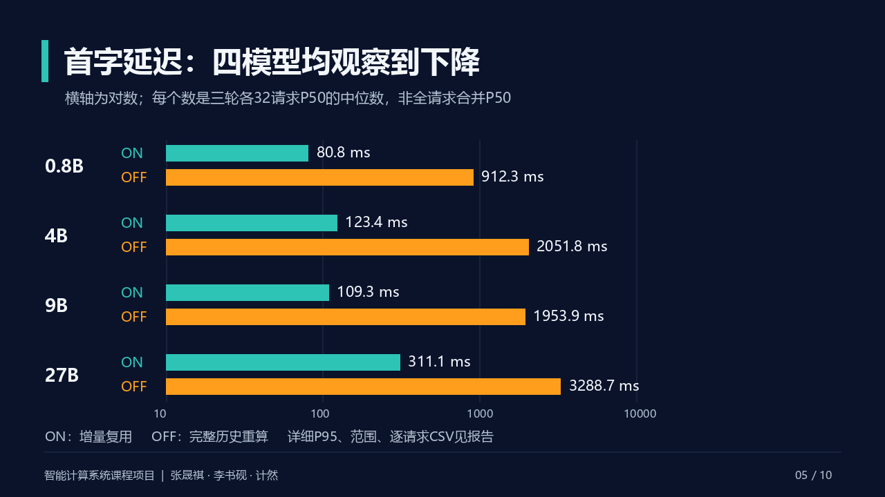

# 答辩演示材料

[打开10页PPTX](course_defense_20261018.pptx)；[配套讲稿与问答](../project/defense_outline.md)；[最终总报告](../report/course_project_final_20261018.md)。

页面采用固定图像呈现，含讲者备注；文字、图形位于页图中，编辑文案或布局请修改生成源再重生。Git同时保留十张PNG、标题/备注JSON和绘制/打包源。生成器还会输出完整PDF与总览，本次PDF作为本地交付附件保留，也可按下述步骤生成。图和表直接读取已核验的R9及最终证据，主性能768正式请求与最终128质量配对分别标明，不混算。



## 检查记录

第一版发现英文词/ON-OFF断行及对数图缺刻度，修正后重新渲染；再修正中文标点行首并检查。已核验十页总览及密集页，PDF由Poppler24.08.0真实渲染十页。PPTX的十张嵌入PNG与公开预览逐项SHA一致，均为无裁剪全页图像，尺寸/备注页数检查通过；本机没有执行Office应用二次渲染。公开生成源格式化后已实际重生成，十页PNG SHA一致；公开打包程序重生的PPTX内十张页图也一致。详见[QA记录](qa_receipt.json)和[原始生成清单](render_manifest.json)。

## 重生成

只在项目本地环境安装/使用依赖：Pillow13.0.0，Node.js与PptxGenJS4.0.1。渲染器不使用NPU。需显式提供本机已有中文字体，当前版本使用Windows微软雅黑常规/粗体，字体文件本身未分发；其SHA记录在生成清单。替换字体会改变像素，数据仍由同一审计输入读取。所有输出目录/文件须全新，不覆盖原材料。

在仓库根、已激活项目本地Python的PowerShell示例：

```powershell
python docs/presentation/runners/render.py --repo . --output-dir .tmp/defense-reproduce --font C:/Windows/Fonts/msyh.ttc --bold-font C:/Windows/Fonts/msyhbd.ttc
npm install --prefix .tmp/defense-runtime --cache .cache/npm --ignore-scripts --no-audit --no-fund pptxgenjs@4.0.1
$env:NODE_PATH=(Resolve-Path .tmp/defense-runtime/node_modules).Path
node docs/presentation/runners/package_deck.cjs .tmp/defense-reproduce .tmp/defense-reproduce.pptx
```

渲染器同时生成十张PNG、PDF、总览、标题/讲者备注JSON和输入/字体/图像哈希。PPTX/ PDF内的时间元数据可不同，逐页PNG应在相同数据、字体和绘制依赖下复现。`slides.json`记录标题/备注，主要文案及绘图在`runners/render.py`；`package_deck.cjs`仅将这些完整页图和备注打包。

三位成员按总报告中的均衡责任域解释实现与结果；实际代码、服务器实验、分析及材料均由AI工具辅助完成，不虚构成员亲自操作、工时或已经完成个人理解核验。教学网由用户本人提交。
