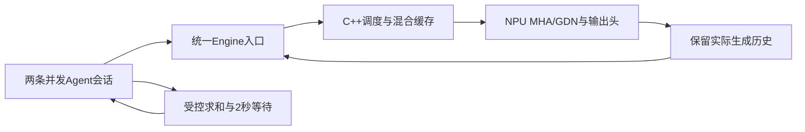
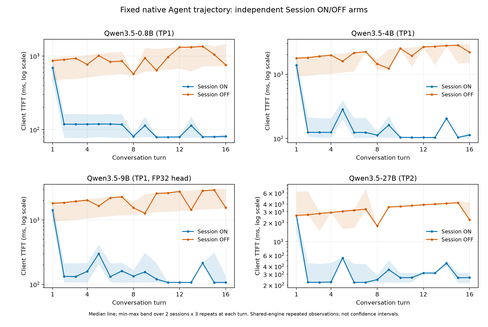

# 面向Agent负载的Ascend大模型推理系统优化

小组成员：张晟祺、李书砚、计然。最终交付分支：`course/final-20261018`。本报告按原始课程要求整理实际实现、四模型部署、正确性、性能、资源及消融证据；旧计划中的探索功能不等于已实现成果。所有实际代码修改、实验执行、数据整理与报告由AI工具辅助完成，成员责任见末节，不虚构成员亲自操作、工时或已经通过个人理解验收。

## 1. 完成范围与系统结构

同一TokenSpeed系统支持Qwen3.5-0.8B、4B、9B、27B文本推理。最终实现沿用上游Tokenizer/Engine入口、C++ continuous-batching调度、混合MHA/GDN模型、分页KV/状态缓存及NPU执行路径，课程改动集成在原fork中。没有另造第二条模型执行路径，也没有把脚本工具等待包装为模型自主工具选择。

计算部分完成训练投影值一致的参考、MHA/GDN及state边界修复与验证；会话部分保留实际旧生成IDs及ChatML当前前沿，修复首次控制查询启动和异常流/部分Session创建的清理；评测部分提供固定revision配置、真实原生会话与全历史对照、逐ID质量门控、独立采样和可复现性能臂。原生Session是调用API选择，配置中未添加不存在的“开启复用”字段。

基于TokenSpeed上游起点`cf4a4f89ae5f9423a9af490d8f3a0613adfba3fd`；上游模块及移植代码的许可证保留，新增公开Python代码使用完整MIT头。未声称独立原创上游调度器、全部算子或缓存系统，也未把未集成的其他引擎能力记为成果。

## 2. 环境、版本与最终配置

实际运行栈为openEuler 24.03/aarch64、项目Python 3.11环境、PyTorch/torch_npu 2.9、CANN8.5、Transformers5.12、Triton-Ascend3.2.1。运行时SoC为Ascend910_9362/Ascend910_93，DMI为Huawei Atlas800I A3，软件系列映射支持Atlas A3/910C判断；主机CPU标识支持Kunpeng920系列，具体CPU子型号没有直接读取。`Chip Version V1`本身不代表“非910C”。原始身份查询与一手来源见[环境](../project/environment.md)和[核实记录](../project/hardware_identity_20261014.md)。

每个实验至多使用同一物理NPU的两个64GiB chip，TP1只用其中一个，TP2用两个；从未并行运行两个本组NPU实验。每次运行重新检查逻辑2/3与物理NPU1两chip映射和所需chip空闲，不中断其他用户任务。可见整机资源不等于本组预算；共享主机背景负载未随机化隔离，affinity和OMP=1写入性能记录。

| 模型 | 固定revision | 最终配置 | 精度/TP |
|---|---|---|---|
| 0.8B | `2fc06364715b967f1860aea9cf38778875588b17` | `configs/final/qwen35_0.8b.yaml` | BF16/TP1 |
| 4B | `851bf6e806efd8d0a36b00ddf55e13ccb7b8cd0a` | `configs/final/qwen35_4b.yaml` | BF16/TP1 |
| 9B | `c202236235762e1c871ad0ccb60c8ee5ba337b9a` | `configs/final/qwen35_9b.yaml` | BF16主体、显式FP32输出头/TP1 |
| 27B | `fc05daec18b0a78c049392ed2e771dde82bdf654` | `configs/final/qwen35_27b.yaml` | BF16/TP2 |

四份final配置与已测基线/9B候选逐字节相同；上下文上限4096，prefix cache关闭、KVStore禁用，使用原生Session留存。它们是证据支持的保守交付选择，不宣称全局最优；未根据最终质量结果改阈值、替换样例或删除失败。

最终完整清单1415项SHA `d05a47d932b519b6e50ed0c668725935d93b744fffffa68e95f37a0227f6c6ea`，相比R9r2只增加四final及两TP候选配置，原1409项实现文件逐字节不变。最终服务器课程软件637通过/零skip；本机同实现603通过/34无Torch跳过。报告/图表/分析程序另按交付allowlist与服务器及Git blob核验，不能只比较Git分支名。

## 3. 正确性采用分层证据

第一次作业独立固定提交`1d113e54f789a22b14cbbdccbc6230c3f4d0e574`已经完成四项任务与报告。该1396项源快照的原16条输入/原16-token固定续接，共272个完整logits向量通过用户事先批准的有限双门槛。主参考为同投影权重CPU FP32/eager，输入manifest原SHA `23dbfc6e21d99b674f0aa40a95374c4a215a7ec838f715692eec12d07f3f22fb`、canonical SHA `f78c051acc44a969210824200d0b3de17dbc32eaca6643b8124383c47f1d4936`。

| 阶段 | relative-L2上限 | max-abs上限 |
|---|---:|---:|
| Prefill每个完整向量 | 0.04160680933973707 | 0.4934459924697876 |
| Decode step1–16每个完整向量 | 0.027781371644764415 | 0.4458632469177246 |

实际Prefill最大值0.021534648897684416/0.32581615447998047，Decode最大值0.019179627022419887/0.4235382080078125。旧1%工程门槛仍有68个向量失败，固定前沿argmax仍有13处不同；它们没有删除或改成通过。冻结数值门槛不等于自由greedy一致，也不由模块state/Session结果替代。HW1服务器569软件、关键模块与Session108测试/203属性通过，NumPy逐向量独立复算一致，见[独立HW1报告](homework1_compute_subsystem.md)及[冻结门槛](../project/homework1_frozen_numerical_gate_20261015.md)。这些旧源测量不改称1415源重采。

9B默认BF16输出头旧八例7/8通过、1/8失败，失败记录保留：长上下文前沿的两个BF16 logits并列，局部CPU FP32与FP64点积诊断支持舍入影响，不能把整个模型误差说成0。显式FP32输出头候选保持已加载BF16学习值，改变计算/存储精度；正式图模式八例raw/stop-aligned均8/8。4B/27B在R5同源旧八例各8/8，对照为既有固定HF参考，未冒称本轮重新收集HF。0.8B八例自由greedy完全一致未证明。详见[头精度分析](../project/9b_lm_head_precision_20261015.md)。

最终1415源对四份final配置各执行2条原生Session×16轮×8输出；每次保留真实实际历史，执行完原生阶段、关闭观测后才串行重算全部32条完整历史。输出IDs和context分别检查，所有128对通过，工具窗口、idle持页、关闭active归零和阶段边界也通过：

| 模型 | 输出/context各通过 | 最大实际上下文 | 工具窗口其他会话完成轮数 | 正活动块样本 | 恢复复用tokens | idle/close active |
|---|---:|---:|---:|---:|---:|---:|
| 0.8b | 32/32 | 1000 | 9 | 19 | 729 | 14.0/0 |
| 4b | 32/32 | 968 | 7 | 19 | 715 | 14.0/0 |
| 9b | 32/32 | 968 | 6 | 19 | 715 | 14.0/0 |
| 27b | 32/32 | 968 | 3 | 19 | 715 | 13.0/0 |

工具为脚本明确执行`sum(range(31))=465`并等待2秒后注入用户文本，不是模型自主发起function call，也未实现服务端WAITING_TOOL枚举。池计数不提供逐Session块归属证明；close后active=0表示解除活动引用，不表示预分配HBM全部释放回系统。

## 4. 独立Session ON/OFF性能与消融

主性能证据为R9r2固定1409源清单`2c9e47616eb3c460a740e2542e776ab655934a9ad7ed0ac0c1401a008a97d712`，提交`82788a85eca26a631222d6ca0d03ac245aff6d9a`。最终1415源的这1409项实现与配置字节完全一致，另完成上述最终配置真实NPU验证；R9运行记录仍按其真实清单标记，不冒称原始文件含新增六配置。

协议固定R8实际轨迹及SHA。每模型双方各完整预热32请求，再按ON/OFF、OFF/ON、ON/OFF进行三轮配对，共192正式/64预热请求。Session ON提交suffix，OFF提交完整实际历史；每次都真实生成，逐ID匹配才纳入通过结果。吞吐为每臂256输出tokens/wall，wall包含工具等待，排除创建/关闭和启动；无同时进行的质量控制请求。

| 模型 | 三轮配对首字P50下降 | 三轮配对输出吞吐比 | 全运行观察HBM峰值 MB（按chip） |
|---|---:|---:|---:|
| 0.8b | 89.11%–91.46% | 3.37–3.46× | 8563 |
| 4b | 93.98%–94.77% | 4.63–4.71× | 16985 |
| 9b | 93.26%–94.43% | 4.19–4.34× | 29063 |
| 27b | 90.39%–92.18% | 3.65–4.47× | 34828/34489 |

完整逐请求CSV、24个正式臂P50/P95、E2E、客户端近似TPOT、全部12配对与原始哈希见[性能报告](../project/native_agent_performance_20261018.md)。TTFT为流式首token客户端时间，近似TPOT=(E2E−TTFT)/7，不是设备kernel时长。每模型三个同Engine内重复不是三个独立进程样本，不报告显著性或置信区间。图中带为2会话×3重复的min/max，非置信区间。原始503文件跨端SHA核对，公开格式化分析器在本机和服务器复算一致。

独立0.25s池计数及npu-smi查询采样，HBM查询结束后等1s；保留查询起止时间与原始表。表中峰值包含预热/臂间，单臂仅统计查询全程落在臂内的样本，无覆盖记null。它是观察峰值、非瞬时峰值，也不等于KV占用。不能从Session加速推断整池HBM下降；共享主机、时序和编译热度仍可能影响重复分布。

### 4.1 输出头精度代价

R5的独立配对成本实验96请求、252 HBM样本，48对输出IDs相同。9B FP32头相对BF16头的Decode成本增加约7.456%–9.329%，观察HBM峰25874→27814MB；参数逻辑额外2034237440 bytes（1.89453125GiB）。这是正确性与资源/延迟的显式取舍，不把精度修复包装成Decode加速；该消融使用R5源，旧协议失败的采样臂及修复过程均保留。

### 4.2 有限TP候选

4B TP2与27B TP1各自只改变原基线的tp_size，固定其他参数/轨迹/质量门控。候选不满足逐ID或资源协议则保留失败、拒绝采用；通过才在同1415源对原TP配置补测匹配性能基线。每个成功配置仍各192正式/64预热，以下为原生Session ON三轮范围；完整ON/OFF见公开audit。

| 配置标签 | 质量/状态 | 资源与性能结果 |
|---|---|---|
| tp4b_tp1_baseline | 192/192正式ID匹配 | ON首字P50 106.95–123.23 ms；输出 28.28–29.05 tokens/s；观察峰 16986 MB |
| tp4b_tp2 | 192/192正式ID匹配 | ON首字P50 111.08–112.19 ms；输出 34.35–35.01 tokens/s；观察峰 11375/11037 MB |
| tp27b_tp1 | no_run_record，退出-10 | configured_cache_capacity_rejected；ValueError: num_lcm_blocks=31 cannot admit one token with the configured qwen_gdn cache scheduler limits；未形成有效性能结果，未采用且原始失败保留 |

TP配置间使用不同Engine、执行次序未跨进程随机反平衡，因此只能作当前固定负载描述性比较，不把差值归因于某一个HCCL子阶段。四份final配置维持已稳定验证的保守基线/精度候选；4B TP1占用一个chip，27B TP2分摊单chip负载并保持既有路径。该选择不等于吞吐或资源的全局最优；未完成的更大并发/任意上下文调优不虚构为已验证。

### 4.3 保留负结果与未采用探索

早期4B staged长Prefill/Decode三轮实验中，chunk=512没有降低本次staged Decode E2E，不作为优化收益；早期完全重复prompt的prefix命中改善只适用于精确重复负载，不外推一般Agent对话。最终prefix cache仍关闭，用原生Session复用实际增长历史。旧GDN/greedy失败、R7工具窗口失败、指标落盘与采样退出失败均保留。R8新增并发控制点也通过，证明不能仅以“存在质量控制请求”解释R7单点；R9因此另做独立性能臂，未拿移动质量控制的阶段时间当收益。

## 5. HW1计算Profiler的结论边界

HW1已在数值验证完成、1396源固定后串行采集最终Decode Profiler，共127个真实Decode steps，无Prefill。conv/state相关任务累计时长36.944%，MatMul21.107%，ViewCopy13.334%；AICore子集MatMul92.15%不是整个Decode占比。trace时间隙不能直接叫设备idle或Host因果瓶颈。HW1另有同源96请求2×2基线、121 HBM样本，Decode约10.8–10.9ms，观察峰8461MB；这与本轮多会话客户端近似TPOT是不同指标和负载，不混表比较。

## 6. 可复现交付与原始任务映射

| 原始要求 | 可检查交付 |
|---|---|
| 同系统部署四模型 | 四个`configs/final`固定revision配置、统一serve/Engine入口、1415源清单及四模型最终NPU记录 |
| 多轮/上下文/并发/工具负载 | 每模型2 Session×16轮，当前前沿、真实历史、2秒受控工具、阶段/close审计 |
| 正确性和模型质量 | HW1冻结全logits与旧失败、模块/state/Session、9B头精度修复、固定HF八例及最终128配对，分层标明边界 |
| 基线/优化/资源/消融 | 四模型独立ON/OFF、9B精度成本、有限TP、历史chunk/prefix负结果，完整CSV/图/观察HBM |
| 代码与环境/评测脚本 | 固定交付分支、环境文档、明确配置、原始SHA、公开分析/绘图与原生验证/性能入口 |
| 报告/汇报/AI披露 | 本报告、HW1独立报告、答辩讲稿/演示材料及下面责任表 |

在项目本地环境中运行完整课程测试及`pre-commit run --all-files`。各硬件命令必须新输出目录、重新查映射和空闲、固定可见chip且串行。启动服务示例`bash scripts/serve.sh configs/final/qwen35_4b.yaml`；原生Session需使用Engine会话API，不把普通HTTP请求自动当原生会话。精确验证/性能/复算命令见[最终交付入口](../project/final_delivery_20261018.md)。不公开凭据、私有服务器地址/帐号或不透明Session IDs，原始完整归档在工作区保留、公开清单提供哈希。

课程统一评测细则未在当前原始要求中给出，本项目报告现有有限协议，不宣称已通过未知隐藏负载。教学网提交由用户本人处理，助手不代交。代码材料可复现不等于已经实际完成学生个人理解考核。

## 7. 成员责任与AI工具披露

三人按“实现责任＋正确性/实验＋报告解释”分配相近规模责任域，不按未记录工时虚构平均数。以下是小组责任边界，不是声称三人已亲自执行实验：

| 成员 | 主要责任边界 | 对应报告与核验关注 |
|---|---|---|
| 张晟祺 | 计算路径、0.8B/4B算子与数值参考、HW1 Profiler | 同投影权重、MHA/GDN/state、冻结门槛、旧失败及Profiler解释 |
| 李书砚 | Session状态与异常生命周期、9B输出头精度与多轮正确性 | 实际历史/current-frontier、工具留存与close、精度代价及回归 |
| 计然 | 四模型部署评测、27B/TP资源、独立性能与集成交付 | ON/OFF协议、原始SHA与复算、配置、吞吐/HBM及最终复现材料 |

实际项目代码、服务器运行、原始数据同步与分析、报告和演示材料均由助手使用AI coding工具辅助完成。回归、独立只读审查、真实NPU实验、完整软件检查与逐文件哈希共同提供证据，AI结论本身不作为通过条件。未记录三人个人操作工时，不编造亲自执行/交叉复核或已经理解。答辩材料提供讲解与问题清单，支持成员按责任域核验理解。
