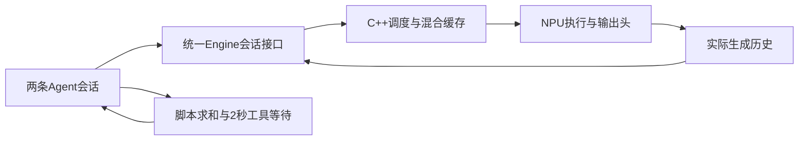
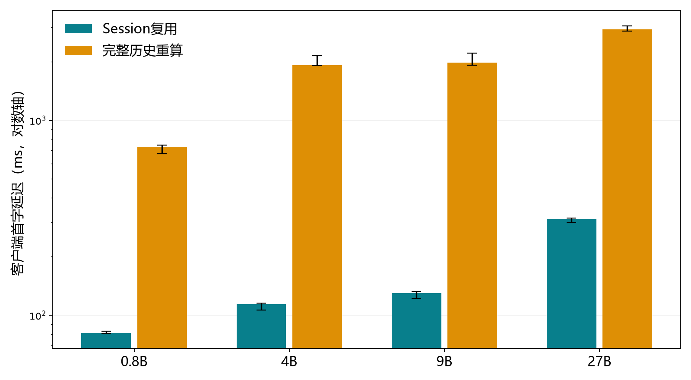
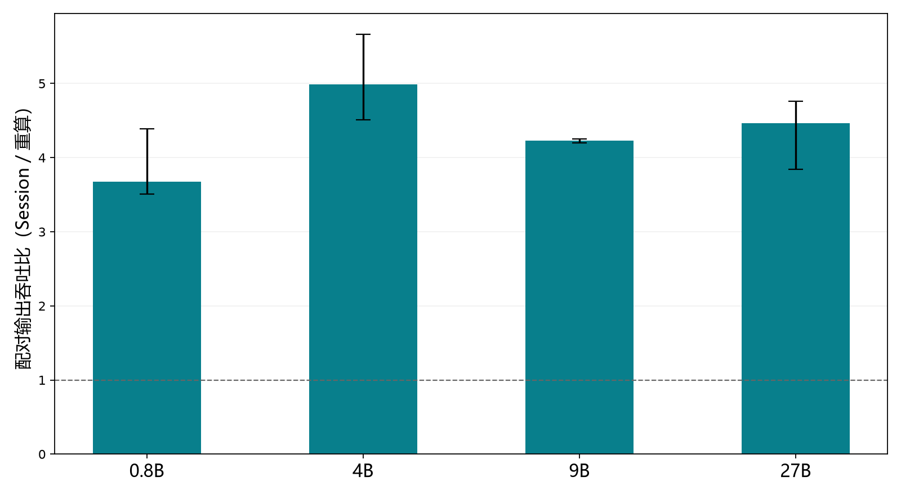
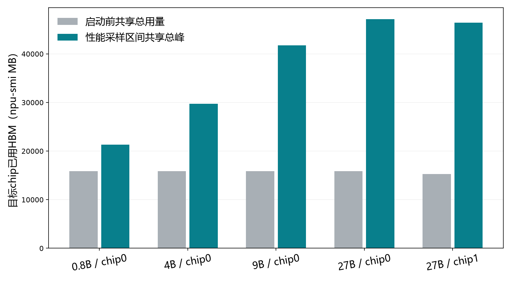

# 面向Agent负载的Ascend大模型推理系统优化

成员：张晟祺、李书砚、计然。当前主线：`project/develop`；实际被测实现固定为`1d6099da5909e38fdbc737fe77bcb4176c978de1`。本报告于2026-11-01整理，原始运行时间采用收据UTC。代码、实验、分析和材料均由助手使用AI工具辅助完成；责任分工不冒充成员亲自操作或工时记录。

四个最终配置在当前源码上完成了原生多轮组合复验与独立Session ON/OFF测量。每模型32组输出和32组完整历史context检查通过，合计各128组；性能合计768正式、256预热请求，全部真实生成并匹配原固定参考IDs。全部8项运行退出0、无超时、设备与退出释放审计通过，本地独立复算与服务器结果一致。结论仅适用于本报告固定轨迹和共享运行条件；课程统一负载、规定Kunpeng资源预算及评测细则尚未取得，尚未验证。

## 1. 原始要求、已有工作与本轮交付

| 课程要求 | 当前可核查证据 | 验证范围与缺口 |
|---|---|---|
| 同一系统部署0.8B、4B、9B、27B | 四份final配置、固定revision和55项模型文件身份、当前源码四模型NPU结果 | 每次至多同卡两chip，串行部署；不是四模型同时驻留 |
| 多轮、工具、上下文增长与多会话 | 两条真实Session×16轮×8输出；完整历史重算；工具窗口、持页、恢复、close审计 | 并发2、实际上下文约1000；不冒称覆盖4096上限、最大配置并发或自主工具选择 |
| 正确性与模型质量 | 当前逐ID/context配对、性能固定轨迹；历史模块、HF参考和数值证据独立保留 | 有限条件一致性不等于任意输入或语义任务质量；历史负结果保留 |
| 优化、基线、资源与消融 | 当前同源码/权重/协议Session ON/OFF、24正式臂、12配对、共享HBM | Session留存是本轮消融变量；不混用旧TP/精度实验时间计算收益 |
| 固定代码、环境与复现脚本 | 1535项源清单、独立工具清单、双端软件、启动导入审计、当前复现入口 | 原始私有日志本地留存；公开SHA和脱敏分析，不分发模型权重或凭据 |
| 报告、汇报、分工与AI说明 | 本报告、当期讲稿和10页演示 | 学生个人理解及教学网提交由成员和用户负责 |
| 统一课程评测和规定主机资源 | 当前记录实时硬件/软件及可见cgroup资源 | 规定预算与细则尚未取得，不声明此项通过 |

20261018阶段报告、HW1和HW2保持各自历史身份。此前完成的模型适配、混合MHA/GDN/state修复、原生Session、实际历史记录、9B精度选择和Profiler不从零重复开发。本轮在作业2选择性代码整合后核查，补动态设备入口、共享保护、当前分析与同源实测；未复制HW2报告或恢复已删除的额外全层/完整logits诊断。

## 2. 系统与优化实现

系统沿用TokenSpeed统一Engine、C++连续批处理调度器、混合MHA/GDN模型和分页KV/状态缓存。`open_session`建立会话，ON臂每轮只提交新的suffix，保留真实已生成IDs并继续相同ChatML前沿；OFF臂在同一Engine中提交完整实际历史进行重算。两臂均关闭prefix cache、禁用KVStore，因此本实验测量的是原生Session持有状态的取舍。没有新增第二条Engine/Session执行路径，也没有通过强制输出参考token制造一致性。

最终采用的计算/缓存路径不改动。本轮两份采集入口新增显式`--npu-id`、`--chip-logic-ids`、`--resource-mode`，取消固定物理卡1/逻辑2、3/chip0假设。TP1可选chip1，设备数量必须匹配TP。显式公共工作区沿用唯一`.tmp/hw2-npu.lock`，避免本组实验互相重叠。

共享守卫持续检查实时映射、背景PID/UID/启动时间、未知进程和剩余HBM。8192MB为每chip运行保护余量，不是课程质量门槛，也不构成对其他用户的资源预留。异常只中断经过核验的本次采集父进程；外层超时清理核实本次会话/进程组身份，不停止原服务。监控在Engine销毁前停止并等待线程结束，退出后再审计映射、来源和自身进程释放。背景PID复用、查询错误、迟到违规及不完整表均保留并拒绝通过。

设备回归涵盖非2/3映射、TP1 chip1、设备数量错误、背景PID复用、未知进程、显存不足、双chip HBM、迟到中断和自身退出。外层清理的两个纯CPU用例均验证本次子进程停止且无关控制进程存活。当前分析器独立读取原始表和阶段/请求记录，历史分析器原样冻结。

上游来源为[TokenSpeed](https://github.com/lightseekorg/tokenspeed)，项目起点`cf4a4f89ae5f9423a9af490d8f3a0613adfba3fd`；原MIT和第三方许可保留。不声称独立原创上游全部算子、调度或缓存。

## 3. 固定源码、环境与最终配置

源码/配置/测试清单1535项，SHA256为`633f4b745e540048325b997dc8357ab8383380dcf70cfe8a1052f6d3865f0d23`。相对整合1532项，1528项不变，仅两份采集入口、两份对应测试改变，新增设备守卫及两份测试；核心Engine、Session、KV和模型计算没有分叉。实际8份驱动/分析/作业工具另见`tool_manifest.json`。后补复现准备和绘图工具单独版本记录，不冒称已用于此前测量。

服务器openEuler24.03 LTS-SP3/aarch64，项目Python3.11.16，Torch2.9.0+cpu与torch-npu2.9.0，Transformers5.12.0，Triton-Ascend3.2.1，tokenspeed-triton3.8.10.post20260920。复用项目既有CANN8.5激活入口。scheduler分发元数据0.1.23，实际导入为当前源码目录内隔离扩展，SHA256 `3931f548933ea65f3449fa032c1e9ff4c71610bdb26ce26872d77cc0afffbeae`；parent/spawn/forkserver均核对来源，不能仅用包版本证明二进制身份。

实时设备选择为物理NPU1，chip0→逻辑2、chip1→逻辑3；这是本轮观察，不作为下次默认。每chip显示65536MB，TP1占一个chip、27B TP2占两个。既有设备身份见[核实记录](../project/hardware_identity_20261014.md)，本轮DMI Atlas800I A3、CPU implementer0x48/part0xd02与640条记录相符。观察cgroup配额160 CPU等价、cpuset0–639、内存1TiB，`OMP_NUM_THREADS=1`；这些是可见共享条件，不等于规定Kunpeng预算。主机并未独占或固定隔离。

| 模型 | 固定revision | TP | 精度 | max_num_seqs配置 | max_total_tokens配置 |
|---|---|---|---|---|---|
| 0.8B | `2fc06364715b967f1860aea9cf38778875588b17` | 1 | BF16 | 16 | 65536 |
| 4B | `851bf6e806efd8d0a36b00ddf55e13ccb7b8cd0a` | 1 | BF16 | 8 | 32768 |
| 9B | `c202236235762e1c871ad0ccb60c8ee5ba337b9a` | 1 | BF16主体 / FP32头 | 8 | 32768 |
| 27B | `fc05daec18b0a78c049392ed2e771dde82bdf654` | 2 | BF16 | 4 | 16384 |

四份配置均为`configs/final/qwen35_*.yaml`，上下文上限4096、block128、chunk4096、memory_utilization0.9；9B显式`hf_overrides.npu_lm_head_dtype=float32`。实验有效配置只将指标端口改为39982，其他值与配置逐项相同并记录哈希。配置上限不是已测负载边界。四模型55文件（含18权重分片）于10月31日完整SHA匹配，随后每次测量前后及整轮退出核对设备号/inode/大小/mtime身份；该stat核对本身不重新计算全部权重SHA。11月1日测量结束后，后补复现准备另外重新核验55文件全SHA通过，见`reproduction_check.json`，不追认为测量前检查。模型不随公开仓库分发。

当前999项课程CPU测试：本机966通过/33跳过，服务器991通过/8跳过，均无失败。服务器8项为Windows专用；本机额外缺Torch、prometheus_client及Windows下Posix/symlink条件等，不把跳过说成设备通过。逐项原因见`software_skips.json`；首次目录分类4失败、过长forkserver路径失败和新分析器HBM记录格式回归均保留在`software_current.json`，纠正准备/分析代码后完整复验，未更改模型输入或判据。软件检查不能代替以下NPU验收。

## 4. 当前原生多轮与工具组合正确性

每模型运行原固定`native_agent_16turn_afterrun_20261017.json`：2 Session×16轮，每轮最多8输出，工具会话0在第8轮前明确执行`sum(range(31))=465`并等待2秒。记录真实生成历史后，原生阶段结束并关闭会话，再串行重算32条完整历史作为对照。比较输出token IDs及context，不在原生计时阶段并发插入质量控制。参考和失败输入没有替换。

| 模型 | 输出/context各通过 | 最大实际context tokens | 工具窗其他完成请求 | 正持页样本 | 恢复复用tokens | idle/close active |
|---|---|---|---|---|---|---|
| 0.8B | 32 / 32 | 1000 | 1 | 19 | 729 | 14 / 0 |
| 4B | 32 / 32 | 968 | 6 | 19 | 715 | 14 / 0 |
| 9B | 32 / 32 | 968 | 6 | 19 | 715 | 14 / 0 |
| 27B | 32 / 32 | 968 | 3 | 19 | 715 | 13 / 0 |

128组输出和128组context均匹配，四模型工具窗均观察另一会话进展、正活动块以及恢复复用，close后active为0。工具结果由脚本注入，是受控等待/并发验证，不是模型自主选择工具或完整任务成功率评测。活动块是池级计数，不能证明每个Session的逐块所有权；active=0也不等于预分配HBM全部归还。最终退出另核实本次NPU进程消失，原有服务身份在仍存在时保持一致。

这证明当前四配置在有限实际历史路径下的Session/重算一致性；不能替代任意prompt、完整4096边界、大并发、所有TP策略的并行正确性或开放语义模型质量。

## 5. 同源性能与Session消融

各模型质量通过后才测性能，继续使用原`native_agent_performance_20261018.json`与R8固定参考轨迹SHA。每模型ON/OFF各预热32请求（合64），正式三轮按ON/OFF、OFF/ON、ON/OFF，共192正式请求；四模型合1024次真实生成，其中768正式、256预热。每条正式和预热输出均检查原参考IDs、真实上下文、复用及关闭，不重生成参考。当前测量与旧R9、HW2数据分别保存。

每臂32请求共256输出tokens，吞吐=256/该臂wall；wall包含脚本工具2秒等待，排除模型启动、创建/关闭Session。TTFT为客户端首次流式token时间，E2E为客户端完成时间，近似TPOT=(E2E−TTFT)/7，包含调度与传输，不是kernel时间。质量重算阶段时长不用于性能加速比。

| 模型 | 三轮配对TTFT P50下降 | 三轮配对吞吐比 | ON tokens/s范围 | OFF tokens/s范围 |
|---|---|---|---|---|
| 0.8B | 87.99–89.15% | 3.51–4.39× | 42.43–44.88 | 9.67–12.27 |
| 4B | 94.04–94.61% | 4.51–5.66× | 28.00–28.78 | 5.06–6.21 |
| 9B | 93.43–94.00% | 4.20–4.25× | 24.79–25.39 | 5.90–5.97 |
| 27B | 89.24–89.79% | 3.84–4.76× | 15.26–15.68 | 3.21–4.08 |

以下为三轮各臂统计值的最小–最大值（ms），完整24臂见`performance_arms.csv`，原始逐请求见四份`performance_*/requests.csv`。

| 模型 | 臂 | TTFT P50 | TTFT P95 | E2E P50 | E2E P95 | 近似TPOT P50 | 近似TPOT P95 |
|---|---|---|---|---|---|---|---|
| 0.8B | ON | 80.85–82.74 | 299.06–475.21 | 170.28–173.58 | 576.63–609.66 | 11.05–11.22 | 19.63–26.26 |
| 0.8B | OFF | 674.93–745.35 | 1081.00–3607.86 | 1185.97–1209.74 | 1517.55–3907.69 | 14.81–88.71 | 112.36–117.46 |
| 4B | ON | 106.17–115.62 | 630.16–1014.26 | 324.94–383.14 | 1192.07–1227.13 | 25.18–25.22 | 45.96–53.88 |
| 4B | OFF | 1903.30–2144.70 | 2890.65–6569.34 | 2475.32–2687.46 | 3069.90–6748.33 | 25.32–25.55 | 207.56–229.35 |
| 9B | ON | 121.81–132.47 | 644.75–1059.41 | 366.91–455.35 | 1297.09–1306.26 | 33.31–33.68 | 50.53–56.32 |
| 9B | OFF | 1912.46–2207.85 | 2883.47–2962.62 | 2529.09–2597.59 | 3151.02–3196.18 | 33.52–33.64 | 195.24–236.52 |
| 27B | ON | 299.36–314.35 | 1481.26–1628.44 | 796.87–808.04 | 1937.81–1988.68 | 51.35–51.57 | 94.06–108.48 |
| 27B | OFF | 2864.66–3055.04 | 4239.55–10695.32 | 3816.91–3891.36 | 4608.37–11057.58 | 51.52–51.64 | 326.52–344.31 |

收益与避免每轮完整历史重算相符；该实验没有分解为某个算子或HCCL子阶段的因果贡献。每模型三轮共用一个Engine，编译/缓存热度及共享主机背景未独立随机化，不是三个独立进程样本，不报告显著性或置信区间。三轮配对范围是当前共享条件下的描述性结果，不能推导独占加速保证或跨引擎领先。

本轮消融只改变Session持有与完整历史重算这一机制，权重、源码、任务配置、输入轨迹、参考IDs和两会话均相同。最终9B头和27B TP策略保持显式固定，不拿旧源时间拼接当前消融。未为了负载中的好结果扩展全部TP矩阵。

## 6. 资源观测与开销

| 模型 | 物理chip | 启动前共享MB | 性能采样观察峰MB | 全阶段守卫观察峰MB | 退出后共享MB | 启动背景进程数 |
|---|---|---|---|---|---|---|
| 0.8B | 0 | 15856 | 21308 | 21308 | 15858 | 4 |
| 4B | 0 | 15857 | 29729 | 29729 | 15857 | 4 |
| 9B | 0 | 15857 | 41739 | 41739 | 15857 | 4 |
| 27B | 0 | 15856 | 47154 | 47154 | 15858 | 4 |
| 27B | 1 | 15266 | 46451 | 46451 | 15266 | 1 |

每行是所选chip总使用HBM，包括原有服务，保留实际背景条件。启动前与退出后相近不证明精确模型净占用；两柱差值也不能替代独立模型计量。性能HBM采样在Engine初始化后开始，覆盖预热、正式及臂间，不覆盖模型加载瞬时峰；守卫从启动前覆盖全阶段，但也只是轮询观察。查询结束后等待1秒，记录实际起止；单臂仅使用整个查询区间落在臂内的样本，没有覆盖即null。不是瞬时峰，也不是单独KV量。

Session以持有活动KV/状态换取少重算；本轮并未证明整池HBM下降。关闭active归零后，缓存池仍可能保留cached页；进程退出才由系统释放本次设备上下文。8192MB实时安全余量与旧观察峰加余量准入仅用于保护共享任务，既不是容量最优解，也不提高质量判据通过率。

## 7. 历史结果、负结果与边界

- HW1旧固定续接的全logits、模块/state和Decode Profiler继续见[独立报告](homework1_compute_subsystem.md)。旧1%门槛有68向量失败、固定前沿13处argmax不同，0.8B自由greedy一致未证明。本轮Session对照不覆盖或抹去它们，也不恢复课程外全层/CPU全模型诊断作为前置。
- 9B默认BF16头历史8例7/8，显式FP32头历史8/8。旧R5头精度消融的Decode成本增加约7.456%–9.329%，HBM观察峰25874→27814MB，逻辑参数额外1.8945GiB，是旧源/旧协议结论；此处只解释选择代价，不当作当前配置新测数据。当前源只验证最终FP32头路径。
- HW2连续生成TP矩阵中0.8B/27B原固定输出一致，4B/9B短输入存在TP差异，继续保留；不能因矩阵运行完成宣称所有并行输入质量已证明。它们不是本轮四配置的全覆盖验证。
- 27B旧默认TP1为缓存/调度容量检查拒绝，不能改写成权重放不下或所有TP1均不可能。95%预算候选已有有效普通生成对照，但不是当前原生Agent组合；本轮采用TP2。旧4B TP2收益、chunk512未获收益、prefix仅适用重复prompt等均保持旧源身份，见[历史报告](course_project_final_20261018.md)。
- 历史HW1 Profiler可解释旧0.8B Decode阶段任务构成，不与当前客户端近似TPOT混算。本轮无新的独占Profiler因果结论；共享性能与池指标已满足所选Session优化的当前配对分析范围。
- 本轮8个硬件尝试均通过，没有更换失败输入、放宽判据或隐藏硬件失败。准备阶段的目录/路径/分析格式错误原日志与SHA仍保留；这些是软件准备或分析问题，不伪装为模型错误，也不删除后再说从未发生。

## 8. 交付、复现、成员责任与AI使用

入口为[当期交付与完整复现](../project/final_delivery_20261101.md)、[当期证据](../evidence/project_agent_20261031/README.md)、[答辩讲稿](../project/defense_outline_20261101.md)及[10页演示](../presentation_20261101/README.md)。`final_verification.json`关联当前软件、八项审计、原始SHA、配置及源码；全部1710个原始运行文件跨端核对，完整日志和归档在私有工作区保留，公开摘要/清单/逐请求CSV脱敏，不发布主机账户、凭据或不透明会话IDs。

新复现准备脚本在新隔离任务目录生成当前CPU、导入、模型stat、工具和ready记录，模型SHA重新核验；明确区分继承的被测源码pre-commit收据与新执行的检查。测量结束后已在服务器实跑该流程：991通过/8跳过、55文件SHA匹配、parent/spawn/forkserver导入一致、两个清理用例通过；另有5个准备工具CPU回归。没有复制旧PID/inode/ready，也未再启动NPU。之后外层驱动沿用同一锁，重新检查实时映射/占用、串行运行、核验退出并独立分析。固定代码后普通推送至`pku/project/develop`，完整pre-commit、DCO和明确allowlist；其他分支/冻结快照保持不改。

| 成员 | 主要责任域 | 对应可核查产物和答辩重点 |
|---|---|---|
| 张晟祺 | 实现与部署 | 同一Engine/算子/缓存路径、四模型配置、环境与设备入口、来源及复现部署 |
| 李书砚 | 正确性与实验协议 | 真实历史/context、参考ID冻结、工具窗口与close、负结果及质量边界 |
| 计然 | 性能与资源分析 | 同源ON/OFF、计时/预热/重复、逐请求CSV、共享HBM与资源边界 |

责任域按实现/验证/分析解耦并保持相近规模，不虚构个人工时或声称三人已经亲自执行全部实验。实际编码、服务器运行、同步、统计、报告和演示由助手通过AI coding工具辅助完成；审查、测试、真实运行和哈希提供证据，AI文字本身不是通过条件。学生需按各自责任理解与核验；本材料不等于个人理解考核已完成。教学网由用户本人提交。未知统一评测、规定主机预算和新增细则仍标注“尚未验证”。
