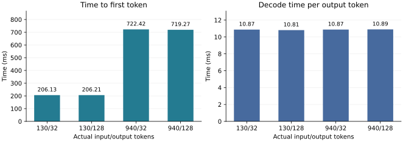
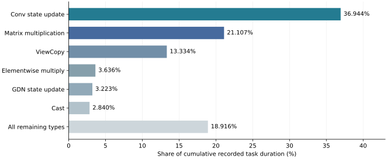

# 智能计算系统课程第一次作业实验报告

**题目：Qwen3.5-0.8B 单 chip Ascend 计算子系统适配与正确性验证**

**小组成员：张晟祺、李书砚、计然**

## 小组分工

| 成员 | 主要责任与交付成果 | 与其他成员的协作边界 |
| --- | --- | --- |
| 张晟祺 | 环境与模型适配：整理依赖和启动配置，负责权重加载、Prefill/Decode 计算接入、算子支持矩阵及 GDN 路径说明；对应第1、2章 | 提供固定实现、配置及张量接口，作为正确性验证与性能测量的共同输入 |
| 李书砚 | 正确性验证：建立独立参考与误差判据，负责典型/边界形状、多步状态、请求隔离和完整模型连续推理的验证及误差分析；对应第3章 | 独立检查实现的输出和状态，反馈可复现问题；验证结论不由性能结果替代 |
| 计然 | 性能与瓶颈分析：负责两档输入×两档输出的测量方案、TTFT/Decode/HBM 数据、Profiler 热点和复现材料；对应第4章及附录 | 在固定计算实现上采集与分析；诊断、Profiler 和正式计时分别运行 |

三人的责任分别覆盖实现、验证与性能分析，各自负责对应章节和证据整理；摘要性结论由三人共同核对。代码编辑、实验执行、数据处理和报告整理使用 Codex AI 工具辅助完成，上表为成果责任分工，不据此认领个人实操或工时。

## 1. 任务一：建立运行环境

### 1.1 实验目标

本实验对应第一次作业的计算子系统要求：在一个 Ascend 910C chip 上运行 Qwen3.5-0.8B，说明模型计算路径及算子支持，建立可信的分层正确性验证，并测得可比较的基础性能。模型主要计算在 NPU 上执行；主机承担请求处理、分词和调度，CPU 高精度计算仅用于离线参考与分析。

### 1.2 硬件、软件与模型版本

| 项目 | 实验配置 |
| --- | --- |
| 服务器与 NPU | Huawei Atlas 800I A3；运行时 SoC 为 `Ascend910_9362`，CANN 系列标识为 `Ascend910_93`；使用单个 64 GiB HBM chip |
| 主机与系统 | Kunpeng 920 系列主机；openEuler 24.03，aarch64 |
| 软件 | 项目 Conda Python 3.11；PyTorch 2.9.0；torch_npu 2.9.0；CANN 8.5.0；Transformers 5.12.0；Triton-Ascend 3.2.1 |
| 模型 | `Qwen/Qwen3.5-0.8B`，revision `2fc06364715b967f1860aea9cf38778875588b17` |
| 权重与并行 | BF16；tensor parallel size=1；主计算不使用 CPU offload |
| 调度与缓存 | 最大上下文 4096，block size=128，chunked prefill size=4096，max_num_seqs=16，max_total_tokens=65536，memory_utilization=0.9 |
| 实验控制 | prefix cache、KVStore、mixed batch、overlap schedule 均关闭；性能测量的客户端并发为 1 |

设备身份依据 SoC、CANN 设备系列和服务器板型确认，详见[硬件记录](../project/hardware_identity_20261014.md)。每项实验记录对应源码、配置和模型版本；本报告各数值与性能实验使用同一计算实现，未将诊断用的额外同步带入性能基线。

### 1.3 启动与连续推理

在已准备好的 Ascend 项目环境中，从仓库根目录激活环境并使用固定配置启动：

```bash
source scripts/use_project_env.sh
# 先核对当前设备映射及空闲，再选择一个可用 chip。
export ASCEND_RT_VISIBLE_DEVICES=2
OMP_NUM_THREADS=1 bash scripts/serve.sh configs/baseline/qwen35_0.8b.yaml
```

设备 2 是本次实验使用的逻辑编号，其他机器应按实时映射选择。该配置启用图执行路径；用于提取完整 logits 的数值诊断单独采用 eager 模式。完整推理结果包括 96 条正式基线请求，覆盖实际 130/940 个输入 tokens 与 32/128 个输出 tokens；所有正式请求均生成规定长度，完成从输入到连续 Decode 的推理流程。

## 2. 任务二：打通模型计算

### 2.1 整体计算路径

模型包含 24 个 decoder layers，其中 18 层为 Gated DeltaNet，6 层为 full attention。hidden size 为 1024，MLP intermediate size 为 3584，词表大小为 248320。Full attention 具有 8 个 Q heads、2 个 KV heads，head dimension=256；GDN 具有 16 个 heads，K/V dimension=128，短卷积核宽度为 4。

```text
输入 Token IDs → Embedding
  → 24 层 Decoder：归一化 → Full Attention 或 Gated DeltaNet → 残差/MLP
  → 最终归一化 → LM head → logits → greedy 采样 → 输出 Token
```

Prefill 并行处理提示词，建立 full-attention KV cache、卷积历史状态和 GDN 递推状态。Decode 每次处理新进入前沿的 Token，读取当前请求的历史缓存并更新对应状态。两阶段共享模型权重，区别主要在张量长度、缓存访问和状态更新方式。

### 2.2 算子功能、形状与精度

表中 N 为本次 forward 的 Token 行数，B 为序列数，T 为序列长度，P 为状态池 slot 数。

| 模块 | 功能与主要输入→输出形状 | 数据类型 |
| --- | --- | --- |
| Embedding / LM head | `IDs[N] → [N,1024]`；采样位置 `[B,1024] → [B,248320]` | 权重与主激活 BF16；诊断保存 logits 时展开为 FP32 |
| Dense / MLP | `[N,1024] → gate/up 各[N,3584] → [N,1024]`，完成线性投影和门控激活 | 权重、输入及输出 BF16 |
| RMSNorm / Gemma RMSNorm | 对 hidden 1024 或 Q/K 末维 256 归一化，保留输入形状；处理残差 | BF16 存储，FP32 归约及有效 gamma |
| Q/K Norm、Q gate、MRoPE | Q/gate 各 `[N,8,256]`，K/V 各 `[N,2,256]`；旋转其中 64 维 | Q/K 归一化在 FP32 中间计算，恢复 BF16；其余 192 维不旋转 |
| Paged MHA | `Q[B,T,8,256]`、`KV[B,T,2,256] → [B,T,8,256]`；page size=128 | Q/K/V 与 KV cache 为 BF16 |
| GDN 投影与拆分 | `[N,1024] → QKVZ[N,8192]`、`BA[N,32]`；拆为 mixed QKV `[N,6144]`、Z `[N,16,128]` 与 a/b `[N,16]` | 投影 BF16；gate 的关键中间计算 FP32 |
| 短因果卷积 | mixed QKV `[N,6144] → [N,6144]`；权重 `[6144,1,4]`；历史状态 `[P,6144,3]` | 输入与历史状态 BF16 |
| GDN 递推 | Q/K/V `[B,T,16,128] → output 同 V`；状态池 `[P,16,128,128]`，末两维为 V、K | 输入/输出 BF16；本次 SSM state 为 FP32 |
| Gated RMSNorm / 输出投影 | 输出与 Z 展为 `[N×16,128]`，归一化及门控后 reshape 为 `[N,2048]`，投影至 `[N,1024]` | norm/gate 中间 FP32，输出 BF16 |
| 采样与输出 | `[B,248320] → Token IDs[B] → 文本` | logits 按模型计算精度处理；Token IDs 为整数 |

### 2.3 实现来源、Ascend 支持与测试方法

| 模块 | 当前实现来源和适配方式 | Ascend 支持及验证方法 |
| --- | --- | --- |
| Embedding、线性层、MLP、LM head | 复用 TokenSpeed Qwen3.5 与并行层，使用 NPU 矩阵运算 | 参与完整 NPU 推理；用全词表 logits 与多长度连续推理验证组合计算 |
| Gemma Norm / 残差 | 复用 NPU RMSNorm；有效 gamma 按 FP32 的 `1+weight` 计算；残差在原 BF16 对象中更新 | NPU 支持；真实宽度、残差结果、gamma 精度和输出 dtype 对照 |
| Q/K Norm、MRoPE、Q gate | 按 head 正确拆分 Q/gate；Q/K norm 后恢复输入 dtype；使用 runtime 实际 MRotaryEmbedding | NPU 支持；packed 非连续输入、位置边界、未旋转维度与 CPU 公式对照 |
| Paged MHA | 复用 Ascend 注意力实现，适配 D256 与分页访问 | NPU 支持；真实 8Q/2KV、非连续页表和 127/128/129 长度的 Extend/Decode 对照 |
| GDN 投影及卷积 | 复用上游合并投影和 Triton-Ascend 卷积路径 | NPU 支持；通道尾边界、双 slot 连续更新、历史移位与未选槽检查 |
| GDN Prefill / Decode | 复用统一 GDN 算子接口；Prefill beta 用 FP32 sigmoid，关键状态计算保持 FP32；显式传入状态读写索引 | NPU 支持；CPU 递推参考、分块边界、近 epsilon 输入及多步状态对照 |
| Gated Norm / 输出投影 | 复用 gated RMSNorm 与输出线性层，保持 norm-before-gate 语义 | NPU 支持；实际宽度 128、超大 rows 边界及 CPU FP32 公式对照 |

本组的适配工作集中在精度、布局和有状态计算的兼容性上。模型主体、线性层、调度器以及大部分 GDN/卷积算法来自 TokenSpeed，未将其作为从零编写的实现；来源及许可证遵循原项目规定。

### 2.4 关键模块：Gated DeltaNet 调用、布局和状态更新

GDN 路径从 `Qwen3_5LinearDecoderLayer.forward` 开始。hidden `[N,1024]` 经过 Gemma RMSNorm 后进入 `_forward_input_proj`，合并投影拆出 mixed QKV、Z、a、b。这里的 QKVZ 布局与 full-attention 的 Q/gate 布局不同，拆分后的维度需分别与各自算子接口匹配。

`ctx.attn_backend.forward` 将上述张量交给 Mamba backend。Prefill 卷积使用 packed sequence 边界；Decode 卷积按请求 slot 读取三个历史位置，与当前输入构成宽度 4 的窗口。执行卷积和激活后，Q/K/V 按 `[B,T,16,128]` 排列。

以 CPU 参考的 K×V 状态方向表示，一个 head 的递推语义为：

```text
q̂t = qt / sqrt(sum(qt²) + ε)，k̂t = kt / sqrt(sum(kt²) + ε)，ε = 10⁻⁶
S̄t = exp(gt) · S(t−1)
δt = βt · (vt − k̂tᵀ S̄t)
St = S̄t + k̂t δtᵀ
yt = q̂tᵀ St / sqrt(128)
```

Prefill 的 NPU 路径显式使用 `beta=b.float().sigmoid()`，通过 `gdn_chunk_prefill` 输出计算结果和最终状态。Decode 通过 `gdn_decode_step` 分别传入 `initial_state_indices` 与 `output_state_indices`，读取前一前沿并写入本次前沿。实际状态池按 `[P,16,V,K]` 保存，因此与 CPU 参考对照时要转置末两维；若只比较范数而不处理方向，会掩盖错误的布局。

算子输出整理后与 Z 一同展为 `[N×16,128]` 做 gated RMSNorm，再合并为 `[N,2048]`，经输出投影返回 hidden `[N,1024]`。状态属于请求对应的 slot；读页和写页可以不同，更新不得改写其他请求或仍需复用的输入页。

设备同步主要涉及调度元数据准备及结果回传。保存 logits、复制到 CPU 和读取标量会额外同步，因此正确性采集与计时分进程执行。状态正确性还受计算前沿约束：刚采样但尚未进入下一次 forward 的 Token，其 KV/SSM 尚未物化；多步和 Session 检查按这个前沿比较。

## 3. 任务三：验证功能正确性

### 3.1 分层方法与误差定义

验证分为三个层次：关键算子检查数值和边界形状；状态模块检查多步递推与请求隔离；完整模型检查同一权重下从输入到全部 logits 的组合结果。离线参考从与 NPU 相同的量化后输入和初始状态出发，使用独立 CPU FP32 公式或递推计算；近 epsilon 的解析自检另用 FP64。

算子逐元素判据为 `|actual−reference| ≤ atol + rtol×|reference|`。同时记录 finite、最大绝对误差和 relative-L2：

```text
relative-L2 = ||actual − reference||₂ / max(||reference||₂, 10⁻¹²)
max-abs     = maxᵢ |actualᵢ − referenceᵢ|
```

BF16 输出允许量化和归约次序带来的误差；FP32 中间状态采用更紧的绝对包络。对纯拷贝、历史移位、未选中 slot、有效 gamma 和未旋转维度等结构性不变量，使用精确相等。以下包络是实测前设定的工程判据，依据包含 BF16 舍入量级、FP32 状态存储及边界测试，不作为任意输入的理论误差上界。

### 3.2 关键算子与模块结果

| 模块 | 典型与边界覆盖 | 参考及主要判据 | 结果 |
| --- | --- | --- | --- |
| RMSNorm、Gemma Norm、实际 MRoPE | 宽度 256/1024；rows 0/1/129/1024；位置 0/1/127/128/4095；旋转 64 维，保留 192 维 | CPU FP32；BF16 Norm atol=0.002、rtol=0.02；MRoPE 0.02/0.02；FP32 额外检查 10⁻⁵；残差/未旋转部分精确不变 | 70 项通过 |
| Canonical Gemma gamma 与 Q/K Norm | 有/无残差、实际 gamma、非连续 Q/K、rows 1/129 | gamma/残差精确相等；canonical 输出 10⁻⁴/10⁻³；Q/K 输出 0.002/0.02 | 3+3 项通过；辅助归约通信采用 mock |
| GDN Prefill / Decode | 16 heads、K/V=128；Prefill 长度 1/8/127/128/129；近 epsilon 级别；双 slot 各连续 8 步及读写槽分离 | CPU FP32 递推；BF16 输出 0.002/0.02；FP32 state 0.0003/0.01；未选槽精确不变；4 项 CPU FP64 解析自检 | 17 项通过，其中 13 项含 NPU 计算 |
| D256 paged MHA | 8Q/2KV；KV 长度 127/128/129；两个非连续页序列；Extend 和 Decode | 独立 CPU FP32 GQA/causal attention；0.02/0.02；七个输入保持不变 | 6 项 NPU 与 3 项 CPU 检查通过 |
| 短因果卷积 | 通道 16/6143/6144；width=4；双 slot 各 8 步 | CPU FP32 点积+bias+SiLU；输出 0.002/0.02；移位和未选槽精确相等 | 3 项通过 |
| Gated RMSNorm | width=128；rows=65536、width=8 的 grid 边界 | CPU FP32 Norm×gamma×SiLU(z)，再量化；0.02/0.02 | 2 项通过 |

以上模块与下节 Session 集成共 108 项测试通过，包含 101 项实际 NPU 计算和 7 项 CPU 解析检查，无 failure、error 或 skip。MHA 跨页测试的观测最大 max-abs 为 0.002144873，最大 relative-L2 为 0.002221517，分别来自不同样例。测试覆盖实际模型维度及关键分块/分页边界，未把它扩展解释为任意形状或真实 TP 通信验收。

### 3.3 多步状态更新与请求隔离

卷积测试在两个 slot 上交错推进，各进行 8 步更新，将每一步输出及三个历史位置与 CPU 参考比较，并检查未选中的 slot 完全不变。GDN 测试同时对输出和 FP32 state 作逐元素对照，增加“从一个 slot 读取、向另一个 slot 写入”的情况，检查输入页与其他页未被覆盖。这些检查分别约束递推数值、历史移位和写入归属。

完整引擎的状态检查使用两个交错原生 Session，将增量执行结果与全历史重算对照。8 组输出 Token IDs 和 context 元数据配对一致；关闭后的 4 次使用均被拒绝，重新建立会话后结果可复现。它验证请求状态的持有、隔离与释放语义；其对照来自同一引擎，不能代替下一节的独立 CPU 数值参考。进程退出码为 0，目标设备资源释放，但 Session 清理日志存在 pending-task 与关闭日志流提示。

### 3.4 完整模型：多输入长度与连续 Decode

完整模型固定同一模型 revision、投影权重数值、精度和续接配置。CPU FP32/eager 缓存路径为主参考，CPU threads=1；NPU 侧为 BF16、TP1、单 chip。验证输入长度为 **1、8、127、128、129、512、1024、2048**，每档两条，共 16 条，相同输入之间独立初始化状态。

每条轨迹保存末端 Prefill 和连续 Decode 第 1–16 步的 **248320 维完整 logits**，共 16+256=272 个向量。使用原固定 16-token 续接使参考与引擎的输入前沿一致；保存的是实际计算出的 logits，续接控制只决定下一步输入。与此同时检查实际输入 IDs、绝对位置和三轴 MRoPE 位置、shape、finite 与缓存前沿。

冻结判据在独立校准后、验证组执行前确定，每个向量必须同时满足 relative-L2 与 max-abs。下表为结果，完整阈值精度见附录。

| 阶段 | 向量数 | relative-L2 上限 | 实测最大 relative-L2 | max-abs 上限 | 实测最大 max-abs | 结果 |
| --- | ---: | ---: | ---: | ---: | ---: | --- |
| Prefill | 16 | 0.04160680934 | 0.02153464890 | 0.4934459925 | 0.3258161545 | 16/16 通过 |
| Decode 1–16 | 256 | 0.02778137164 | 0.01917962702 | 0.4458632469 | 0.4235382080 | 256/256 通过 |

这说明当前计算实现在指定多长度、固定前沿协议下满足约定误差范围。独立 NumPy 复算的判定、最大绝对误差及 argmax 与原分析一致，relative-L2 重算差约为 2.50×10⁻¹⁵；重复采集得到的 272 个张量文件逐项相同。

**仍存在的数值边界：**若采用额外的 1% relative-L2 工程门槛，本批有 68 个向量失败；固定前沿下有 13 个向量的 argmax 与参考不同。因此，本实验没有证明自由 greedy 输出逐 Token 相同，自由生成的长上下文分叉也未被上述结果消除。通过的结论是固定协议下的完整 logits 误差验收，不能用它取代生成质量评价。第4章的连续推理基线说明系统能够完成规定长度请求，并不另行宣称输出与参考完全一致。

## 4. 任务四：建立性能基线

### 4.1 测量方法

性能实验使用第 1 节配置，客户端并发为 1，分别组合短/长输入和短/长输出。目标输入为 128/1024 tokens，经网关提示词构造与分词后，**实际输入为 130/940 tokens**；输出固定为 32/128 tokens。四种条件各预热 3 次，再测 3 轮，每轮 8 个请求，共 96 条正式请求。没有提前结束的正式请求。

计时在无 logits 诊断、无 Profiler 的独立进程中完成。TTFT 从客户端发出请求计至首个输出 Token，包含 Prefill、服务和主机侧开销。客户端 TPOT 为首 Token 后剩余生成时间除以 `输出 Token 数−1`；服务端 ITL mean 由时间直方图的 sum/count 差分得到。表中 TTFT、TPOT、E2E 为“每轮 P50 的三轮均值”，不是把全部请求合并后求 P50；ITL mean 和吞吐量也按三轮汇总取均值。

### 4.2 两档输入与两档生成长度的结果

| 输入 tokens | 输出 tokens | TTFT (ms) | TPOT (ms/token) | 服务端 ITL (ms/token) | E2E (ms) | 输出吞吐 (token/s) |
| ---: | ---: | ---: | ---: | ---: | ---: | ---: |
| 130 | 32 | 206.133 | 10.868 | 10.862 | 543.207 | 58.919 |
| 130 | 128 | 206.211 | 10.806 | 10.793 | 1577.973 | 81.179 |
| 940 | 32 | 722.418 | 10.872 | 10.963 | 1060.191 | 30.101 |
| 940 | 128 | 719.266 | 10.893 | 10.887 | 2103.297 | 60.891 |



**图 1.** 同一配置下，输入从 130 增至 940 tokens 时，TTFT 从约 206 ms 升至约 720 ms；Decode TPOT 在四种条件下保持约 10.8–10.9 ms/token。柱顶为三轮汇总值，不表示置信区间。

输入增长主要影响首 Token 之前的阶段：短、长输出条件下均能观察到约 3.5 倍 TTFT。Decode 指标变化较小，说明本组测量范围内增加提示词主要增加 Prefill 及首 Token 前处理成本。生成长度增加时，固定首 Token 成本被更多输出摊薄，输出吞吐随之提高。TTFT 包含 HTTP 和主机开销，不能由这组延迟差直接计算纯 Prefill kernel 耗时。

服务端 ITL 的每轮计数分别为 `8×31=248` 和 `8×127=1016`，与扣除首 Token 后的输出间隔数一致，为 Decode 统计口径提供了交叉检查。

### 4.3 HBM 占用

使用独立 `npu-smi` 采样器，按实际目标 chip 解析设备占用，覆盖服务启动、两档输出负载和退出。共 121 次查询，均正常返回；每次查询后等待约 1 秒，最大相邻查询起点间隔为 2.148 秒。

| 阶段 | 目标 chip HBM 设备占用 (MB) |
| --- | ---: |
| 服务启动前 | 3112 |
| 模型加载且 health 检查通过后 | 8459 |
| 32-token 输出负载采样最大值 | 8461 |
| 128-token 输出负载采样最大值 | 8461 |
| 服务退出后 | 3113 |

负载期最大观测值为 8461 MB；相对启动前增加约 5349 MB。这里统计的是驱动报告的整个目标 chip 占用，包括已有基础占用、权重、状态池、缓存和执行缓冲，不能视为有效模型 tensor 或 KV cache 专属大小。采样包含条件预热，可能遗漏短时尖峰。退出后设备占用恢复到接近启动前的水平。

### 4.4 Decode Profiler 测量范围

为区分 Prefill 与 Decode，使用独立原生请求采集稳态 Decode。输入为 128 tokens；先执行 3 个生成 8 tokens 的预热请求，随后单请求生成 256 tokens。在首个输出之后开始采集，到累计 128 个输出时停止采集，然后继续完成请求。采集使用 Level1 和 `ACL_AICORE_PIPE_UTILIZATION`。

记录中有 762 次 full-attention 调用，等于 6 层×127 步；GDN Decode 与卷积更新各为 18 层×127 步=2286 次，且没有 GDN chunk Prefill 算子。这些计数确认所分析窗口为连续 127 步 Decode。Profiler 导出和采集会扰动请求时延，因此该请求不进入4.2节性能样本。

### 4.5 算子任务时间与主要瓶颈

| 算子类别 | 任务数 | 累计 Task Duration 占比 |
| --- | ---: | ---: |
| 卷积状态更新 | 2286 | 36.944% |
| 矩阵乘法 MatMulV2 | 12319 | 21.107% |
| 布局拷贝 ViewCopy | 3302 | 13.334% |
| 逐元素乘法 Mul | 12446 | 3.636% |
| GDN Decode 状态更新 | 2286 | 3.223% |
| 数据类型转换 Cast | 18415 | 2.840% |



**图 2.** 分母为全部 108331 行算子记录的累计 Task Duration，合计约 981676.691 μs。不同任务可能重叠，因此图中的百分比不是请求墙钟时间的互斥分解；“其余类型”为剩余所有类型的合计。

卷积状态更新是本次最大的单类任务时间来源，ViewCopy 也具有显著占比，表明状态访问和布局处理值得优先检查。矩阵乘法承担投影与输出层计算，占比约 21.1%；GDN 递推更新本身约为 3.2%。据此，后续优化顺序应为：先检查卷积状态更新及相邻布局拷贝，考虑减少中间搬运或融合连续操作；再检查矩阵投影与小算子发射开销。每种优化仍需维持完整状态更新和本报告的正确性验证。

### 4.6 Prefill、Decode 与开销归因

只统计带 AICore 计数的任务时，MatMul 占比约 92.15%；这个子集遗漏大量卷积更新等任务，不能代表全部 Decode。MatMul 的原始搬运流水计数高于 MAC 计数，加上 ViewCopy/Cast 的记录，支持进一步研究数据访问成本；流水可重叠，且 HBM 带宽原始单位未独立校准，尚不能给出可信的带宽利用率或纯访存墙钟占比。

任务时间线包络约为 1.532 秒，所记录任务区间的并集约为 0.996 秒，未覆盖区间约为 0.535 秒，最大间隙约为 1.406 ms。未覆盖可能涉及主机发射、同步或未记录活动，现有 trace 不能把它全部归因于主机调度或设备空闲。

Prefill 与 Decode 的计算结构不同：Prefill 的投影和 GDN chunk 输出/W-U 重算可以批量处理，Decode 需要逐步维护请求状态。本次基线量化了输入长度对首 Token 阶段的影响，并给出了独立 Decode 热点；既有 Prefill/Decode 混合 trace 也能看到矩阵乘法和 GDN chunk 计算，但不据此编造纯 Prefill 的分项耗时。当前证据足以确定优先优化候选，尚不足以完成计算、访存和主机开销的全部因果分解。本报告没有报告未经同配置对照验证的加速比。

## 5. 作业1总结

本实验在 Ascend 910C 系列单 chip 上完成了 Qwen3.5-0.8B 的权重加载、Prefill、Decode、状态维护与连续推理。复用模块主要是模型骨架、线性层、调度和现有算子；适配设计主要解决 Gemma/QK 归一化精度、Q/gate 及状态方向的布局一致性、D256 分页访问与状态读写索引问题。最大的困难是混合 full-attention 与 GDN 模型中多种缓存布局和精度边界同时影响完整输出，单个模块输出 finite 不足以说明组合实现正确。

关键模块、边界形状和多步隔离验证通过，完整模型在固定 16 条轨迹的 272 个 logits 向量上满足冻结判据。较严的 1% 条件及 argmax 仍有失败，故结论限定于已给出的协议，不宣称自由生成逐 Token 相同。

短/长输入和短/长输出的性能基线已建立：TTFT 约 206–722 ms，Decode 每 Token 约 10.8–10.9 ms，HBM 负载采样最大占用为 8461 MB。Decode 的首要优化候选是卷积状态更新与相关布局拷贝，依据是同一计算实现的独立 Profiler，而非算子名称或旧快照之间的性能差。

## 附录：复现入口与数据来源

### A. 实现、模型和输入身份

本报告使用 HW1 实验快照 `1d113e54f789a22b14cbbdccbc6230c3f4d0e574` 中的计算实现。1396 项源码清单 SHA-256 为 `f44d5c85b1d9bfe30d3e04177fa6d4b5daf773564ee0a5611c07179fa2acb34e`。源码清单包含对应的实现、配置和测试，用于核对本报告实验的复现身份。

验证输入来自 `configs/validation/homework1_inputs.json.gz`，解压文件 SHA-256 为 `23dbfc6e21d99b674f0aa40a95374c4a215a7ec838f715692eec12d07f3f22fb`；canonical SHA 为 `f78c051acc44a969210824200d0b3de17dbc32eaca6643b8124383c47f1d4936`。同投影权重的 320 个参数共同数值指纹为 `c2084362ae79d1d0f3d61a9781598296fae0944efe4e6fd04888a48692c57884`。

完整向量判据的全部有效数字如下，复现时不得使用正文表格四舍五入后的值：

```text
Prefill: relative-L2 ≤ 0.04160680933973707，max-abs ≤ 0.4934459924697876
Decode : relative-L2 ≤ 0.027781371644764415，max-abs ≤ 0.4458632469177246
```

### B. 测试与采集入口

在上述 HW1 实现的独立检出中，激活现有 Ascend 环境、确认所需 chip 空闲后执行。各输出路径使用新目录。

| 实验 | 入口与输出 |
| --- | --- |
| 关键算子/状态 | `test_homework1_norm_rope_npu.py`、`test_gemma_rmsnorm_canonical_npu.py`、`test_qk_norm_fp32_gamma.py`、`test_gdn_homework1.py`、`test_gdn_prefill.py`、`test_mha_homework1.py`、`test_causal_conv1d_homework1_npu.py`、`test_layernorm_gated_npu.py`、`test_homework1_session_npu.py`；完整路径见[复现命令](../evidence/hw1_20261015/README.md) |
| 完整模型参考与采集 | `scripts/collect_homework1_validation_reference.py`、`scripts/run_homework1_stage_b.py`、`scripts/analyze_homework1_stage_b.py` |
| 性能基线 | `scripts/serve.py`、`scripts/run_benchmark.py`；固定 2×2 编排文本在公开证据目录 |
| Decode Profiler | `scripts/run_homework1_decode_profile.py`；数值验证通过且源码固定后，在独立干净进程运行 |

以下公开数据均对应本报告的实验快照，可通过[证据目录](../evidence/hw1_20261015/README.md)查看文件说明及完整命令。大型 logits、原始 trace、退出日志和 XML 的文件哈希已记录；模型权重及完整原始采集不随报告打包。

| 正文结果 | 对应数据 |
| --- | --- |
| 关键模块与请求状态108项验证 | `verification.json`；含原 XML 与测试源码 SHA |
| 完整 logits 误差与失败 | `numerical_vectors.csv`、`numerical_summary.json`、独立复算与重复采集审计 |
| 延迟、吞吐和 HBM | `baseline_summary.csv`、`baseline_audit.json`、`hbm_samples.csv` |
| Decode 范围和算子分布 | `decode_scope_audit.json`、`decode_op_types.csv`、`decode_profiler_summary.json` |

表格和图 1、图 2 均由上述数据整理。文中历史硬件结果只归属于该实现与实验协议。
