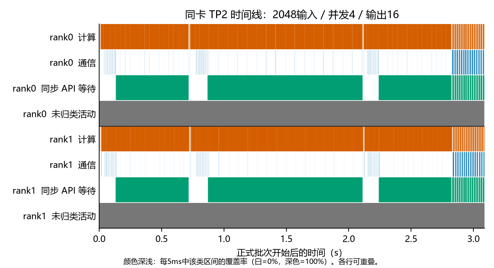
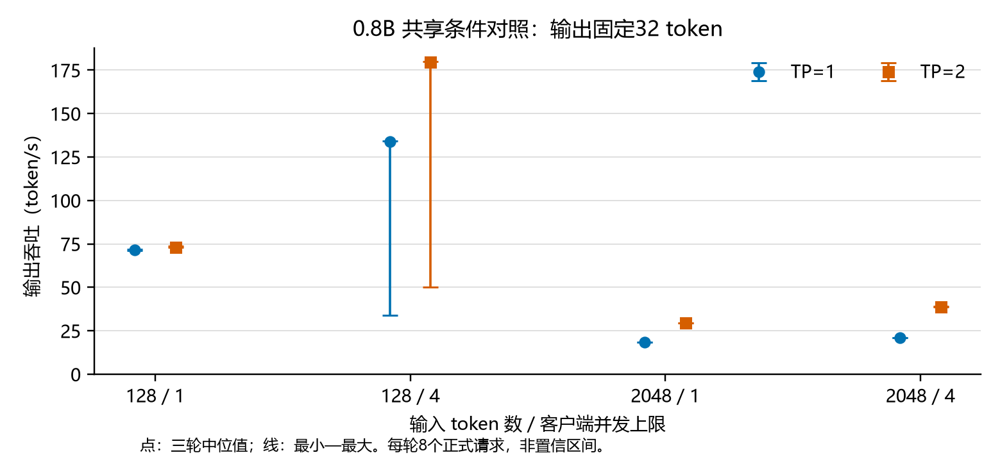

# 智能计算系统作业2实验报告：双 chip 并行与通信分析

小组成员：张晟祺、李书砚、计然。实验与数据整理截至2026年10月26日。

本报告按作业2的四项任务组织。四模型均完成同卡TP2连续推理；0.8B与27B在原固定32输出协议下与TP1一致，4B与9B的原短输入差异仍未解决；另补充四模型八条语义请求的TP1/TP2及CPU参考比较，保留表达差异、代码截断和内容质量问题。新增数据覆盖0.8B两长度×两并发的TP1/TP2性能、逐chip显存、双rank设备时间线，以及27B性能和容量；减小Prefill分块的策略实验取得了性能下降的结果。以下所有性能结论限定于记录了后台占用的共享环境。

## 小组分工

| 成员 | 作业2责任与交付成果 | 与作业1的接续及协作边界 |
| --- | --- | --- |
| 张晟祺 | 双 chip 适配：配置、权重分片、进程与设备绑定、典型层及状态分布说明、固定源复现材料 | 延续环境与模型适配责任；交付固定实现和张量接口，供验证、测量使用 |
| 李书砚 | 正确性验证：权重与负载身份、双 rank 运行证据、TP1/TP2 输出配对、独立参考及分叉定位 | 延续独立验证责任；保留失败与可复现差异，不以速度或自一致性代替正确性 |
| 计然 | 性能与通信分析：两长度×两并发矩阵、逐 chip HBM、双 rank 时间线、分块策略及大模型容量 | 延续性能与瓶颈分析责任；使用固定实现与负载，正式计时和 Profiler 分开采集 |

三项工作分别形成实现、验证、测量交付包，按相近的成果责任分配；任务覆盖与结论由小组共同核对。**代码编辑、实验执行、数据处理和报告整理由 Codex AI 工具在本组授权下完成；上表表示成果责任，不据此认领三人的亲自操作或工时。**

## 1. 任务一：完成双 chip 适配

### 1.1 环境与实现范围

实验设备为 Huawei Atlas 800I A3，SoC 为 `Ascend910_9362`，CANN 系列为 `Ascend910_93`；每次 TP2 选择同一 NPU ID 下两个 chip，四模型分别加载、运行。环境为 Python 3.11、PyTorch `2.9.0+cpu`、torch_npu 2.9.0、Transformers 5.12.0、Triton-Ascend 3.2.1、CANN 8.5.0。包版本中的 `+cpu` 按元数据记录；实际 NPU 执行由设备映射、worker 日志及运行记录证明。[硬件身份](https://github.com/jiran-1111/tokenspeed_PKU/blob/homework2/in-progress/docs/project/hardware_identity_20261014.md)、[依赖记录](https://github.com/jiran-1111/tokenspeed_PKU/blob/homework2/in-progress/docs/evidence/homework2_20261023/runtime_dependencies.json)

实现复用 TokenSpeed 的 Engine、C++ 调度器、分片加载器和 HCCL 后端。四组 `qwen35_*_tp{1,2}.yaml` 成对配置仅改变 `tp_size`；TP2 启动两个 worker，设置 rank 并绑定逻辑设备，以互补分片共同计算同一模型。四模型主实验沿用1531项核心运行源，SHA256 为 `2a1a2196dba54928cc0bde375eb8412df0c222f8cf98cf4ff94c9f66c13f2af3`；采集与诊断工具另留身份。各模型 revision、权重文件和精度在比较前后核对。主计算为 BF16，GDN SSM 状态为 FP32；9B 输出头另为 FP32，两种 TP 保持一致。[源清单](https://github.com/jiran-1111/tokenspeed_PKU/blob/homework2/in-progress/docs/evidence/homework2_20261023/source_manifest.json)、[模型身份](https://github.com/jiran-1111/tokenspeed_PKU/blob/homework2/in-progress/docs/evidence/homework2_20261023/model_artifacts.json)

本轮功能、性能及 Profiler 允许在获准的共享条件下执行，每次重新读取映射、后台进程身份及显存余量；只清理自身实验进程。共享占用对性能和 HBM 归属的限制在第3、4章分别说明。

### 1.2 典型4B层的切分与通信

4B 的 hidden 宽度为2560，MLP中间宽度为9216，共32层，其中8层 FA、24层 GDN。权重按 `[输出维,输入维]` 表示，T 为实际调度行数；以下是配置与加载器推导的逻辑形状。两 rank 同形但持有互补 heads 或通道，输入 hidden 与残差复制。[模型几何](https://github.com/jiran-1111/tokenspeed_PKU/blob/homework2/in-progress/docs/evidence/homework2_20261023/model_geometry.json)、[切分与代码位置](https://github.com/jiran-1111/tokenspeed_PKU/blob/homework2/in-progress/docs/project/homework2_tp_layout.md)

| 步骤 | rank0 | rank1 | 分布与通信 |
| --- | --- | --- | --- |
| 输入 hidden、残差 | `[T,2560]` | `[T,2560]` | 复制 |
| FA Q/gate/K/V 融合权重 | `[5120,2560]` | `[5120,2560]` | 各逻辑段沿输出 heads 切分 |
| FA 投影后 Q/gate；K/V | 各 `[T,8,256]`；各 `[T,2,256]` | 同形、互补 heads | 本地注意力 |
| FA 输出投影 | 权重 `[2560,2048]`；部分和 `[T,2560]` | 同形、互补输入通道 | SUM all_reduce |
| GDN Q/K/V/z/b/a 融合权重 | `[6176,2560]` | `[6176,2560]` | 六段分别切分 |
| GDN 投影后张量 | Q/K各 `[T,8,128]`；V/z各 `[T,16,128]`；b/a各 `[T,16]` | 同形、互补 heads | 本地卷积与状态更新 |
| GDN 输出投影 | 权重 `[2560,2048]`；部分和 `[T,2560]` | 同形、互补输入通道 | SUM all_reduce |
| MLP gate/up | 融合权重 `[9216,2560]`；激活 `[T,4608]` | 同形、互补通道 | 两投影分别切分中间通道 |
| MLP down | 权重 `[2560,4608]`；部分和 `[T,2560]` | 同形、互补输入通道 | SUM all_reduce |
| embedding、输出头 | 各 `[124160,2560]` | 各 `[124160,2560]` | 词表分片；embedding 后 all_reduce，logits 后 all_gather |

每层只执行 FA、GDN 中的一种，再接 MLP；融合权重按逻辑段切分，不能将 checkpoint 整块按字节二等分。输出头的局部 logits 为 `[S,124160]`，all_gather 得到 `[S,248320]`，S 为需要输出 logits 的位置数。

### 1.3 推理状态与双 rank 执行

FA K/V cache 沿 KV heads、GDN 卷积及 SSM 状态沿本地 heads 切分；请求 ID、位置和逻辑块编号保持一致。下表是每 rank、每层、每个逻辑缓存槽的形状，不包含槽数量。

| 模型 | FA单个K或V块 | GDN卷积状态（BF16） | GDN SSM状态（FP32） |
| --- | --- | --- | --- |
| 0.8B | `[128,1,256]` | `[3072,3]` | `[8,128,128]` |
| 4B | `[128,2,256]` | `[4096,3]` | `[16,128,128]` |
| 9B | `[128,2,256]` | `[4096,3]` | `[16,128,128]` |
| 27B | `[128,2,256]` | `[5120,3]` | `[24,128,128]` |

四模型 FA head_dim 均为256，GDN K/V head_dim 均为128，卷积核宽度为4；`A_log`、`dt_bias` 沿 V heads 分片并保留 FP32。词表大小均为248320；0.8B/4B共享 embedding 与输出头权重，9B/27B不共享。

四模型均已完成同卡双 chip 连续生成。首轮 TP2 的 rank0/1 位于 NPU ID 1 的 chip0/1（逻辑设备2/3），保存启动、正式请求窗口中的真实前向调用、逐 chip HBM 及退出记录。图重放不会逐 token 触发 Python 前向观察器，调用数不能当作 Decode 步数；运行记录也不等于已抓取全部层中间张量。[双 rank 实机证据](https://github.com/jiran-1111/tokenspeed_PKU/blob/homework2/in-progress/docs/evidence/homework2_20261023/hardware_supplements_20261024.json)

## 2. 任务二：验证并行正确性

### 2.1 比较协议

TP1/TP2 保持 revision、权重、dtype、tokenizer、输入 IDs 和采样参数一致；关闭 Session、prefix cache 与 KVStore，设置 `temperature=0`、`ignore_eos=true`，固定输出32 tokens。核对双 rank 实际参与、请求完成状态与长度，再逐 token ID 比较，保留首差位置及两侧输出。有限 greedy 一致仅支持被测序列，不能代替 logits 数值检查或任意输入正确性；作业1误差门槛不自动成为跨 TP 验收标准。

### 2.2 四模型输出比较

| 模型 | 首轮TP2功能协议：正式一致请求 | 新增主矩阵序列比较 | 限制与异常 |
| --- | --- | --- | --- |
| 0.8B | 16/16 | TP1/TP2各96正式+16预热，正式96/96一致 | 仅覆盖两种不同输入 |
| 4B | 8/16 | 未新增通过结论 | 128输入首差为第18个输出：198/271 |
| 9B | 8/16 | 未新增通过结论 | 128输入首差为第10个输出：25389/35378 |
| 27B | 16/16 | 新TP2与同源前次TP1逐条96/96一致 | 两侧均为95%预算；前次TP1耗时不构成新性能配对 |

首轮协议为128/2048输入×并发1/4，每格4预热、4正式、1轮；TP1参考事前固定为原补测同格第1轮的请求0–3。4B、9B的8个失败均来自128输入，2048输入一致。新增主矩阵每格4预热、3轮各8正式，共96正式、16预热。**所有这些重复调用只覆盖128、2048两个独特输入，不是16或96个独立样例。**[首轮比较与失败](https://github.com/jiran-1111/tokenspeed_PKU/blob/homework2/in-progress/docs/evidence/homework2_20261023/hardware_supplements_20261024.json)、[新增矩阵与序列证据](https://github.com/jiran-1111/tokenspeed_PKU/blob/homework2/in-progress/docs/evidence/homework2_20261025/shared_performance.json)

27B默认TP1因缓存/调度容量不足拒绝请求，`num_lcm_blocks=31`，不能写成权重已证实放不下；事前固定的95%预算候选获得47页并完成96正式请求，TP2使用同预算。默认失败与候选均保留。9B早期两次采集因退出监控冲突失败，未追认为成功。2026-10-15/18的旧源结果另保留身份，不与本轮源拼接。CPU软件测试亦不替代上述NPU证据。[软件验证范围](https://github.com/jiran-1111/tokenspeed_PKU/blob/homework2/in-progress/docs/evidence/homework2_20261023/software_verification.json)

### 2.3 共同前沿、逐层与首层诊断

对4B分叉前共同17个输出、9B共同9个输出，在 eager 下固定续接，分别捕获18、10个完整248320维 logits；保存真实输入、位置、缓存续接、本地 argmax 及广播结果。强制续接在原采样后替换发出ID，不修改 logits。CPU参考采用同投影权重的独立 FP32/eager 实现。

| 模型 | 向量数 | TP2相对TP1最大relative-L2 | 最大max-abs | 同前沿argmax一致 |
| --- | --- | --- | --- | --- |
| 4B | 18 | 0.30816710 | 6.046875 | 17/18 |
| 9B | 10 | 0.38528013 | 12.304101 | 9/10 |

各项最大值可来自不同步骤。4B末步TP1的198/271分数均为21.125，TP2为21.125/21.25，支持并列选择受低精度影响的解释，但不能解释其更大的 Prefill 向量差异；9B末步差异也不能简单归为末端BF16舍入。[完整向量](https://github.com/jiran-1111/tokenspeed_PKU/blob/homework2/in-progress/docs/evidence/homework2_20261023/frontier_diagnosis_20261024.json)

32层共65个规范化边界仅比较实际最后token行，第一层输入相同，注意力后即出现差异并在部分位置放大。进一步抓取**第0层GDN及其MLP**的完整128行操作数；每模型10项参数×TP1/rank0/rank1共30项分片均逐位匹配。QKVZBA重组投影relative-L2为4B的0.00002225、9B的0.00008193，注意力行投影规约后增至0.00336435、0.00240218。该层HCCL返回值等于两rank实际部分和经BF16舍入的结果。此检查没有覆盖FA或全模型；eager末步虽重现原图模式首差，仍不能撤销原自由输出失败或将差异全部认定为正常。[逐层诊断](https://github.com/jiran-1111/tokenspeed_PKU/blob/homework2/in-progress/docs/evidence/homework2_20261023/layerwise_diagnosis_20261024.json)、[首层核对](https://github.com/jiran-1111/tokenspeed_PKU/blob/homework2/in-progress/docs/evidence/homework2_20261023/first_layer_diagnosis_20261024.json)

### 2.4 独立HF参考与未采纳精度候选

HF11在同权重、同前沿下显式关闭 matmul、卷积两项HF32，并核对权重、状态及logits文件身份。HF NPU FP32相对CPU FP32的最大relative-L2为4B的0.00027410、9B的0.00005271，argmax分别18/18、10/10。该结果支持独立参考间误差较小，不能认证原运行核心或图模式。BF16参考沿用HF10，卷积开关状态未记录，且GDN缓存为BF16、原运行时SSM为FP32，不支持单因素归因。

| 外部覆盖候选（均未采纳） | 4B最大relative-L2／argmax一致 | 9B最大relative-L2／argmax一致 |
| --- | --- | --- |
| R7：提高行投影输出与SUM精度 | 0.22511805／16/18 | 0.16997695／9/10 |
| R8：再提高残差存储与累积精度 | 0.20715290／18/18 | 0.25554309／10/10 |
| R9：再改变列投影计算精度 | 0.13989776／18/18 | 0.27689970／10/10 |

这些候选改变数学路径，结果呈混合变化；R8/R9的4B末步两种TP均选198，CPU仍选271。未新增验收门槛，未修复原4B/9B自由输出差异，也不能据此排除核心bug。[补充数值证据](https://github.com/jiran-1111/tokenspeed_PKU/blob/homework2/in-progress/docs/evidence/homework2_20261025/additional_numerical_capacity.json)

### 2.5 四模型多输入生成比较与质量边界

为补充前述仅有两种独特输入的限制，另在生成前冻结六类、八条请求：中文介绍、英文问答、算术、Python代码、上下文召回及固定前史的三轮记忆。各模型实际输入长度依次为19、25、26、26、979、21、55、86。四模型各执行CPU FP32/eager参考、原生TP1和TP2，共32条CPU及64条NPU输出；三种配对共96组比较，但不是96个独立样例。此协议显式设置`enable_thinking=False`、greedy、遇EOS停止、最多128输出，不能与第2.1节固定32输出协议混计。参考使用与运行时相同的BF16投影权重值，再转FP32计算；`A_log`、`dt_bias`保留FP32。

| 模型 | TP2与TP1完整ID一致 | TP1与CPU完整ID一致 | TP2与CPU完整ID一致 |
| --- | --- | --- | --- |
| 0.8B | 6/8 | 6/8 | 6/8 |
| 4B | 8/8 | 7/8 | 7/8 |
| 9B | 8/8 | 8/8 | 8/8 |
| 27B | 8/8 | 6/8 | 6/8 |

表中计数表示完整输出token IDs逐位相同，**不是答案正确率**；EOS对齐后计数也完全相同。0.8B英文回答分别为“Paris is the capital of France.”和“The capital of France is Paris.”，信息相同而ID不同；其上下文召回也有表达差异。4B差异是首轮项目代号的确认措辞；27B与CPU差异是北京介绍的文案及代码示例注释。新9B的8/8不撤销原128输入下的分叉。

质量观察保留两类负结果。第一，0.8B和9B的代码题三路均达到128输出上限：0.8B停在参数检查或裸`return`，9B停在`raise`，均未形成完整求和实现，不能据输出一致声称代码功能通过；4B和27B给出了`return sum(numbers)`主体，但本实验没有执行生成代码。第二，0.8B三路相同的北京介绍包含“东方巴黎”“世界文化遗产”等未经核实称谓，说明与参考一致也不保证事实正确。算术、英文首都及上下文召回的所问信息能够从本批文本中读出，但没有据此设定一般质量通过率。

输入manifest的SHA为`1e8e3ae38444191c7dd9d90ffa97b30f730e9e7ab98a2a7fc7a9e17b2d7ef774`，生成后未换题、删失败或调整上限。27B首次TP1在初始化阶段触发共享余量保护，尚未生成请求；失败保留。随后在确认空闲的单chip上使用既有独占保护完成TP1，TP2仍使用原共享保护，模型和95%配置不变。所有成功运行均核对核心源及外层进程退出/设备释放凭证。本批不用于性能结论，未采完整logits；固定前史也不证明原生Session状态。[冻结协议、全部输出及比较证据](https://github.com/jiran-1111/tokenspeed_PKU/blob/homework2/in-progress/docs/evidence/homework2_20261026/semantic_quality.json)

## 3. 任务三：分析通信路径

### 3.1 通信位置、内容与作用

每次模型前向包含embedding后的SUM all_reduce、每层注意力输出投影后的SUM all_reduce、每层MLP down后的SUM all_reduce，以及词表logits的all_gather；rank0采样后broadcast采样ID，使两个rank推进同一请求。行投影发送的是各rank的部分结果，SUM后得到复制hidden；all_gather拼接互补词表分数。FA KV与GDN状态本地更新，不把全部缓存当作每步通信内容。同步API用于等待已提交工作，不能与通信传输时间等同。

以0.8B为例，24层的理论每次前向有49个all_reduce、1个all_gather及1个broadcast；hidden宽1024，BF16行投影的逻辑载荷是每rank的`[T,1024]`，局部logits为`[S,124160]`。实际协议与数据类型以设备trace中的opName/dataType/count核对；算法内部分包、图重放、外层范围及内层设备任务可能各占一个事件，事件数不能直接当集合通信调用数，也不据此推算物理链路字节数。

### 3.2 时间线方法与采集可信度

单独采集0.8B TP2的128/2048输入×并发1/4，固定输出16 tokens，每格4预热及4正式请求。主矩阵和两个策略各一份双rank Profiler，三份都实际完成输出与设备释放。它们与第4章输出32 tokens、未开Profiler的性能实验分开，不能相互替代。

采集使用torch_npu Level1与MSTX标记，保留官方CANN原生时间线；原Engine合并导出失败的文件原样保留，不作为有效硬件时间线。分析输入是原CPU准备数据与同worker的完整官方设备数据组成的新文件，保存两侧SHA、事件数量及顺序，未修改原文件、删事件或重写时间戳。仅允许CPU准备数组在原导出协议处缺少的结尾闭合；原生设备JSON必须本来完整。

每rank用MSTX标记和主机单调时钟建立区间锚，逐格检查覆盖；主矩阵每rank26个锚，偏移不确定度约9微秒，两策略约8–12微秒。仅将`Ascend Hardware`进程且`Stream N`线程上的已知任务类型计为设备活动。通信明确匹配已验证的Hccl Allreduce/Allgather/Broadcast范围，以及图重放的`allreduceAicpuKernel`、`allgatherAicpuKernel`、`broadcastAicpuKernel`。其他AI_CPU任务不会因任务类型而被算作通信；主机enqueue也不计入设备通信。

令C、H分别为一个rank测量窗内计算、通信区间的并集，则分别报告`|C|`、`|H|`及`|C∩H|`，共同覆盖为`|C|+|H|−|C∩H|`。内外层通信事件重叠也先取并集，避免重复计时。主机同步等待单列；两rank的值均不相加成端到端耗时。未知任务及未覆盖区间保留，不能称作设备空闲或纯HCCL等待。

### 3.3 双rank正式窗口结果

单位为毫秒。墙钟为整个正式批次的主机窗口，每格4个请求，其他列是该rank窗口内区间并集。

| 输入 | 并发 | rank | 批次墙钟 | 计算C | 通信H | 重叠 | 主机同步等待 |
| --- | --- | --- | --- | --- | --- | --- | --- |
| 128 | 1 | 0 | 1249.30 | 684.73 | 621.49 | 409.66 | 483.11 |
| 128 | 1 | 1 | 1249.30 | 687.43 | 531.54 | 377.02 | 485.44 |
| 128 | 4 | 0 | 570.14 | 385.97 | 154.50 | 126.84 | 209.43 |
| 128 | 4 | 1 | 570.14 | 387.35 | 196.54 | 109.31 | 259.53 |
| 2048 | 1 | 0 | 3674.74 | 3246.55 | 535.77 | 439.95 | 2791.31 |
| 2048 | 1 | 1 | 3674.74 | 3252.29 | 512.16 | 389.57 | 2857.24 |
| 2048 | 4 | 0 | 3089.61 | 2945.50 | 183.44 | 147.25 | 2591.56 |
| 2048 | 4 | 1 | 3089.61 | 2956.48 | 169.43 | 134.94 | 2595.11 |

图1：2048输入、并发4的正式批次。每5毫秒显示该类区间覆盖率，各行可以重叠；精确统计来自原始区间而非图像像素。灰色为保留的未归类活动，包括控制或标记任务，不能算作“空闲”。主机等待与设备工作可以同时发生，等待多不等于通信完全没有执行。

较长输入的计算区间明显增加；分片带来的矩阵计算变化、集合通信及调度共同影响端到端表现。观察到的重叠只说明被分类范围在时间上相交，不能据此认定采用了最优通信重叠算法，范围内也可能包含等待。完整逐格统计、锚和输入文件SHA见[设备时间线证据](https://github.com/jiran-1111/tokenspeed_PKU/blob/homework2/in-progress/docs/evidence/homework2_20261025/native_profile_summary.json)。

## 4. 任务四：对比实验与通信策略

### 4.1 性能协议与共享环境

主代表模型为0.8B，使用128与2048两档精确输入IDs、客户端并发上限1与4，输出固定32 tokens。各配置每格4个预热请求，3轮各8个正式请求；每个TP共96正式、16预热。两TP使用同一张卡（NPU ID 0）及同源配置；后台三个受保护进程的身份稳定，chip0后台进程显存合计3761 MB，chip1无后台进程。身份稳定不表示算力和带宽负载恒定。

每轮吞吐为正式输出tokens总数除以批次墙钟时长，表中为三轮中位数及最小—最大范围；它不是置信区间。延迟由客户端逐请求计时：TTFT从提交到首个非空输出，E2E从提交到流结束；表中分位数合并本格24个正式请求，仅描述有限样本。近似TPOT按`(E2E−TTFT)/31`另存证据，不冒称设备每步时间。所有轮次均保留，无异常轮剔除。

### 4.2 0.8B两长度×两并发对照

吞吐单位token/s；延迟单位ms。

| TP | 输入 | 并发 | 吞吐 中位[最小,最大] | TTFT P50 | E2E P50 | E2E P95 |
| --- | --- | --- | --- | --- | --- | --- |
| 1 | 128 | 1 | 71.59 [71.24, 71.89] | 112.37 | 448.08 | 450.20 |
| 1 | 128 | 4 | 133.99 [33.91, 134.18] | 390.97 | 954.63 | 6593.02 |
| 1 | 2048 | 1 | 18.58 [18.57, 18.60] | 1381.45 | 1722.70 | 1724.46 |
| 1 | 2048 | 4 | 21.16 [21.11, 21.17] | 4099.62 | 6051.52 | 6063.99 |
| 2 | 128 | 1 | 73.21 [72.87, 73.60] | 87.04 | 436.23 | 445.79 |
| 2 | 128 | 4 | 179.52 [50.26, 179.81] | 206.17 | 729.90 | 4357.08 |
| 2 | 2048 | 1 | 29.64 [29.58, 29.65] | 712.66 | 1076.32 | 1097.17 |
| 2 | 2048 | 4 | 38.81 [38.72, 38.92] | 2100.44 | 3303.27 | 3310.86 |

图2：三轮正式吞吐的中位值及完整范围。四格TP2/TP1观察比值依次为1.023、1.340、1.596、1.834。这是本次共享条件下的结果，不能作为独占环境加速比保证，不能把全部变化归因于通信。128/并发4两种TP的首轮均明显更慢，已反映在范围及E2E P95中；现有证据不足以将其单独归因为后台负载或首次编译。

### 4.3 每chip HBM与独立补测

下表每格为“本项目进程显存峰值 / 整chip已用显存峰值”，单位按设备查询原值MB记录。只使用查询起止均在正式批次内的样本，同次查询的进程与父子关系区分本项目/受保护后台/无法归属部分。它是采样观察，不是连续瞬时峰值、纯模型权重或独占需求；两列峰值也可能来自不同次查询。

| 输入 | 并发 | TP1 chip0 | TP2 rank0/chip0 | TP2 rank1/chip1 | 采样来源 |
| --- | --- | --- | --- | --- | --- |
| 128 | 1 | 5400 / 12526 | 4200 / 11287 | 3980 / 6815 | 独立补测/card2 |
| 128 | 4 | 5402 / 12528 | 4203 / 11289 | 3983 / 6817 | 独立补测/card2 |
| 2048 | 1 | 5536 / 12311 | 4203 / 10936 | 3983 / 6829 | 主矩阵/card0 |
| 2048 | 4 | 6032 / 12807 | 4391 / 11124 | 4171 / 7017 | 主矩阵/card0 |

128短窗口在原主矩阵有采样缺口，故另在card2做两种TP各128正式、8预热的延长补测，每格64正式请求，正式窗均有完整样本。card2的chip0后台合计4119 MB，chip1无后台；这组是独立HBM实验，不回填card0原轮次，也不替换第4.2节的性能数据。个别预热窗口未采到HBM不影响这里正式窗覆盖结论，原缺口仍存档。2048两格则直接取原card0三轮完整样本。不同chip的峰值不相加成同时发生的整卡峰值。

### 4.4 27B的TP2性能与容量

27B使用95%预算、相同两长度×两并发及32输出主协议，96正式与16预热均完成；缓存47页。并发是客户端在途请求上限，缓存约束可能让调度器排队，不能声称任一时刻设备都同时执行4个请求。下表延迟单位ms，HBM为正式窗本项目/整chip采样峰值MB。

| 输入 | 并发 | 吞吐 中位[最小,最大] | E2E P50 | chip0 HBM | chip1 HBM |
| --- | --- | --- | --- | --- | --- |
| 128 | 1 | 17.81 [17.71, 17.92] | 1786.32 | 30903 / 37638 | 30691 / 33539 |
| 128 | 4 | 40.66 [40.64, 40.77] | 3145.15 | 30906 / 37640 | 30694 / 33542 |
| 2048 | 1 | 5.59 [5.58, 5.59] | 5726.61 | 31252 / 37987 | 31040 / 33888 |
| 2048 | 4 | 6.82 [6.81, 6.85] | 18778.63 | 32018 / 38753 | 31806 / 34654 |

独立容量探针实际完成4095输入+1输出，1预热、1正式请求，两rank均执行真实前向并正常退出；这证明当前配置的4096边界请求能运行，不是独占硬件最大上下文或数值正确性的证明。前一次容量探针请求完成但退出清理检查失败，仍保留为失败。默认预算的TP1缓存页不足也保留；未将较早TP1耗时与本表相除构造大模型加速比。[27B容量与数值补充](https://github.com/jiran-1111/tokenspeed_PKU/blob/homework2/in-progress/docs/evidence/homework2_20261025/additional_numerical_capacity.json)

### 4.5 通信粒度实验：Prefill分块4096与512

假设是减小每次Prefill行数可缩小行投影的集合通信载荷，同时增加前向和同步次数，可能改善调度响应，也可能降低吞吐。选择0.8B TP2、2048输入、并发4、32输出；只将`chunked_prefill_size`从4096改为512，其余数学实现、模型、dtype、Session及采样设置固定。两策略各4预热、3轮各8正式，均24/24输出与固定TP1前缀一致。另用16输出的独立Profiler验证机制。

| Prefill分块 | 吞吐 中位[最小,最大] | TTFT P50 | E2E P50 | 近似TPOT P50 |
| --- | --- | --- | --- | --- |
| 4096 | 38.47 [38.45, 38.65] | 2108.29 | 3311.11 | 39.89 |
| 512 | 33.66 [33.63, 33.67] | 2065.65 | 3803.01 | 55.94 |

以下为另采的Profiler正式批次，每策略4个请求、16输出；时间为ms，前向行数只指实际记录的Prefill，不将图重放误计为Python前向。

| 分块 | rank | Prefill形状:次数 | 批次墙钟 | 计算C | 通信H | 重叠 |
| --- | --- | --- | --- | --- | --- | --- |
| 4096 | 0 | {'[4096]': 2} | 3070.49 | 2933.12 | 153.67 | 119.85 |
| 4096 | 1 | {'[4096]': 2} | 3070.49 | 2932.56 | 155.61 | 126.74 |
| 512 | 0 | {'[512]': 16} | 3736.68 | 3277.18 | 328.86 | 242.83 |
| 512 | 1 | {'[512]': 16} | 3736.68 | 3275.77 | 420.94 | 202.76 |

每rank的Prefill由2次4096行变为16次512行，总输入仍为8192行。这直接证明Prefill前向次数增加；按第3.1节固定通信位置，支持集合通信启动次数随之增加的机制解释，不能用内外层设备事件数充当逻辑调用数。通信并集和批次时间需结合表中实测，不用事件数量简单相加。普通计时中512的吞吐比4096下降12.52%，E2E中位数升高。本协议下没有观察到吞吐收益；不能推断小分块在所有混合负载都更差，也不能把全部代价单独归因于HCCL。[完整普通计时、所有轮次与HBM](https://github.com/jiran-1111/tokenspeed_PKU/blob/homework2/in-progress/docs/evidence/homework2_20261025/shared_performance.json)

## 5. 结论与复现材料

四个模型的同卡TP2部署、双rank连续运行、典型层/状态切分说明、跨TP比较、代表模型性能矩阵、逐chip HBM、设备时间线、大模型容量及通信粒度实验均已取得材料。正确性结论仍有边界：原固定32输出协议下0.8B与27B配对一致，4B、9B的128输入比较失败，诊断和精度候选没有修复该问题；新增八条语义请求中TP2/TP1一致数为6/8、8/8、8/8、8/8，0.8B和9B代码截断、0.8B共同不可靠称谓也说明生成一致不等于答案正确。因此本报告展示已完成的验证过程及其失败，不宣称四模型所有数值均验收通过，完整大项目也尚未完成。

核心运行源始终为1531项固定清单`2a1a2196dba54928cc0bde375eb8412df0c222f8cf98cf4ff94c9f66c13f2af3`，新增采集、HBM归属及时间线工具单独固定身份。所有新旧失败保留；早期导出失败不以补一个括号冒充硬件采集，早期性能/时间线的有限统计也不覆盖最终图重放分类结果。原始文件归档保存在本地工作区，公开仓库发布不含账户信息的摘要、源SHA与工具快照。完整复现入口及各批次归档校验见[证据索引与复现说明](https://github.com/jiran-1111/tokenspeed_PKU/blob/homework2/in-progress/docs/evidence/homework2_20261025/README.md)。

补充的FA、实际KV、GDN状态、权重和局部数学检查见[诊断记录](https://github.com/jiran-1111/tokenspeed_PKU/blob/homework2/in-progress/docs/project/homework2_gdn_projection_diagnosis_20261026.md)；这些检查缩小了排查范围，仍未解释全模型放大的完整来源。后续针对原4B/9B失败继续定位；任何数学路径修改均须重新固定源码并重做对应验证，不能借当前性能数据认证新实现。作业1原冻结验收协议不因本报告改变。
